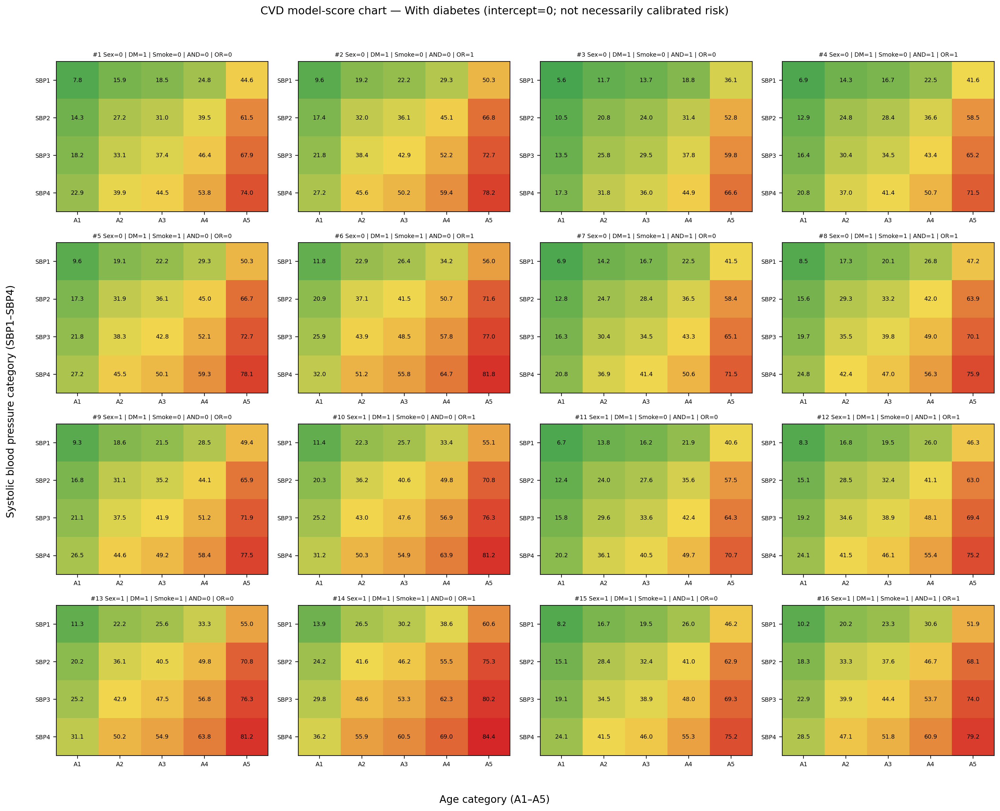
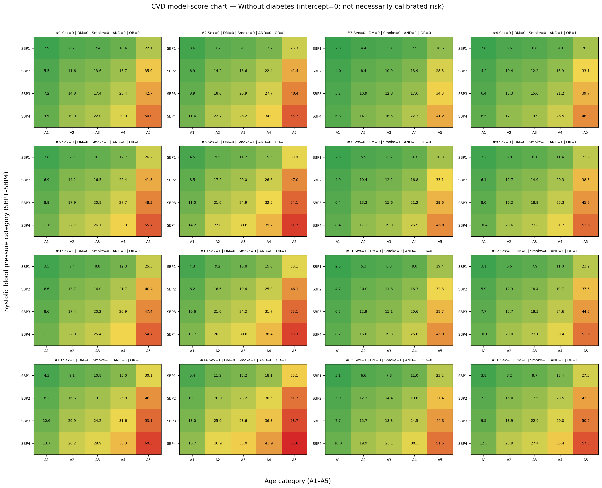

# CVD Stress Risk Chart

**Research code for statistical analysis and logistic-regression modelling of cardiovascular disease (CVD), with a focus on psychological stress and derived stress-related interaction variables.**

> **Repository status:** Private research repository. Individual-level data are not included. This project is for research and educational use only; it is not a clinically validated diagnostic or decision-support system.

## Research overview

This project accompanies a thesis investigating the relationship between psychological stress and cardiovascular disease using data from the Isfahan Healthy Heart Program (IHHP) and the PHQ-4 questionnaire.

According to the thesis:
- The original cohort included 6,504 adults from Arak, Isfahan, and Najafabad.
- After merging the relevant datasets and excluding records with missing values, the analysed dataset contained 3,277 participants: 395 with the CVD outcome and 2,882 without it.
- The binary outcome is `CVD5` (0 = no CVD, 1 = CVD).
- Stress alone was not statistically significant in the reported analysis. Logical combinations of stress with other variables were therefore examined.
- The final logistic model used seven model inputs: age category (`Agec`), systolic blood-pressure category (`sbp`), sex, diabetes (`DMHx`), smoking (`sms2cat`), `pANDDMHX`, and `pORsms2cat`.

The cohort data are private and are intentionally excluded from this repository. See [`data/README.md`](data/README.md) for the expected local input files.

## Methods and code map

| Step | Method / purpose | Script |
|---|---|---|
| 1 | Merge IHHP cohort data with PHQ-4 data | `src/01_merge_data.py` |
| 2 | Descriptive statistics and group comparisons in R | `src/02_descriptive_table.R` |
| 3 | Phi association matrix for binary variables | `src/03_phi_correlation.py` |
| 4 | Biserial association between age and binary variables | `src/04_biserial_correlation.py` |
| 5 | Logistic probability function using thesis coefficients | `src/05_logistic_function.m` |
| 6 | Logistic-regression evaluation with training-fold preprocessing and SMOTE | `src/06_model_evaluation.py` |
| 7 | Enumerate and visualize the model output across risk-chart profiles | `src/07_risk_chart.py` |

The scripts are research-code components rather than a fully automated end-to-end pipeline. Some stages require intermediate files produced during the original analysis and/or local copies of the private dataset.

## Reported thesis results

The following values are transcribed from the thesis results tables. They are **reported thesis results**, not a claim that the revised evaluation script in this repository reproduces the same numbers. The revised evaluation script uses a leakage-conscious pipeline, so its metrics may differ.

### Logistic regression coefficients

| Model term | B | Exp(B) |
|---|---:|---:|
| Agec(1) | -2.257 | 0.105 |
| Agec(2) | -1.453 | 0.234 |
| Agec(3) | -1.267 | 0.282 |
| Agec(4) | -0.894 | 0.409 |
| DMHx | 1.045 | 2.843 |
| sms2cat | 0.227 | 1.255 |
| pANDDMHX | -0.354 | 0.702 |
| pORsms2cat | 0.230 | 1.259 |
| sbp(1) | -1.261 | 0.283 |
| sbp(2) | -0.578 | 0.561 |
| sbp(3) | -0.294 | 0.745 |
| sex(1) | 0.190 | 1.210 |

Reference categories reported in the thesis: `Agec(5)` and `sbp(4)`. The Hosmer–Lemeshow significance value reported in the thesis is 0.740.

### Evaluation metrics reported in the thesis

| Metric | Reported value |
|---|---:|
| Accuracy | 0.74 |
| Precision | 0.23 |
| Recall / Sensitivity | 0.59 |
| F1-score | 0.33 |
| ROC-AUC | 0.75 |
| Specificity | 0.76 |
| Matthews correlation coefficient | 0.24 |
| Mean 5-fold cross-validation score | approximately 0.70 |

The outcome groups were imbalanced (approximately 12% CVD in the analysed sample). Interpret accuracy and precision in that context.

## Risk-chart enumeration and important interpretation notes

The thesis describes 640 combinations. The chart script now enumerates:

- 5 age categories (`Agec` 1–5);
- 4 systolic blood-pressure categories (`sbp` 1–4);
- all \(2^5 = 32\) combinations of the five binary model inputs (`sex`, `DMHx`, `sms2cat`, `pANDDMHX`, `pORsms2cat`).

This gives **32 × 5 × 4 = 640 model-output cells**. For readability, the script writes two figures, one for profiles with diabetes and one without diabetes (16 panels per figure).

**Logical-combination caveat:** The five binary model inputs are enumerated independently to match the 640-combination count described in the thesis. However, `pANDDMHX` and `pORsms2cat` are derived logical variables and may be constrained by the underlying stress, diabetes, and smoking values. Some independently enumerated profiles may therefore be logically inconsistent. Check the original Appendix 7 code and variable-generation rules before interpreting every panel as a realizable participant profile.

### Intercept and calibration caveat

The source MATLAB appendix uses an intercept of zero. The SPSS `Constant` value must be verified against the original SPSS output before interpreting the model output as an absolute probability. By default, `src/07_risk_chart.py` retains the source intercept of zero and labels the figures as **model scores**, not calibrated absolute clinical risks.

After verifying the SPSS constant, set it before running the chart:

**Windows PowerShell**
```powershell
$env:CVD_INTERCEPT="-X.XXXX"
python src/07_risk_chart.py
```

**macOS / Linux**
```bash
CVD_INTERCEPT="-X.XXXX" python src/07_risk_chart.py
```

Replace `-X.XXXX` with the verified numeric constant. Do not use a guessed value.

### Example chart outputs

The following figures are generated with the source intercept of zero. They are included as reproducible visual examples only; do not interpret them as calibrated absolute risks.

**Profiles with diabetes**



**Profiles without diabetes**



## Repository structure

```text
cvd-stress-risk-chart/
├── README.md
├── LICENSE
├── requirements.txt
├── .gitignore
├── data/
│   ├── README.md
│   └── .gitkeep
├── src/
│   ├── 01_merge_data.py
│   ├── 02_descriptive_table.R
│   ├── 03_phi_correlation.py
│   ├── 04_biserial_correlation.py
│   ├── 05_logistic_function.m
│   ├── 06_model_evaluation.py
│   └── 07_risk_chart.py
├── results/
│   ├── README.md
│   └── .gitkeep
└── docs/
    └── GITHUB_GUIDE.md
```

## Requirements

- Python 3.10 or later (the thesis environment used Python 3.12.4)
- R 4.3.3 or later and the R packages `table1` and `readxl` for the descriptive-table script
- MATLAB R2023b or compatible MATLAB version for `05_logistic_function.m`
- SPSS 27 was used for the original logistic-regression analysis

Install Python dependencies:

```bash
python -m venv .venv
```

Activate the environment:

```bash
# Windows PowerShell
.venv\Scripts\Activate.ps1

# macOS / Linux
source .venv/bin/activate
```

Then install packages:

```bash
python -m pip install --upgrade pip
pip install -r requirements.txt
```

## Running the scripts

### Generate the risk-chart figures

This script uses the coefficients documented above and does not require the private participant dataset:

```bash
python src/07_risk_chart.py
```

It creates:
- `results/risk_chart_diabetes_model_score.png`
- `results/risk_chart_no_diabetes_model_score.png`

By default, the figures use the source intercept of zero and are explicitly labelled as model scores. Supply `CVD_INTERCEPT` only after verifying the SPSS constant.

### Evaluate the logistic model

Place the required local intermediate workbook at `data/6varcateg.xlsx`, then run:

```bash
python src/06_model_evaluation.py data/6varcateg.xlsx
```

The script writes ROC, precision–recall, and confusion-matrix figures plus `results/metrics.txt`.

**Evaluation implementation note:** Unlike the original simple preprocessing sequence, the revised script puts standardization and SMOTE inside an imbalanced-learn pipeline. They are fitted only on the training partition (and independently within each cross-validation fold), reducing preprocessing leakage. Therefore, the resulting metrics may differ from the thesis-reported values.

### Other analysis scripts

The remaining scripts require the local data files described in [`data/README.md`](data/README.md). Run them from the repository root unless a path is supplied explicitly.

```bash
python src/01_merge_data.py
Rscript src/02_descriptive_table.R
python src/03_phi_correlation.py data/final_data.xlsx
python src/04_biserial_correlation.py data/final_data.xlsx
```

Run the MATLAB function from MATLAB after preparing an input matrix with the column order documented in the function header.

## Data privacy

- Do not commit raw or participant-level data.
- Do not commit identifiable or potentially re-identifiable information.
- The `.gitignore` file excludes common data formats and files inside `data/` by default.
- Before publishing any aggregate results, confirm that sharing is permitted by the relevant institution, ethics approval, and data-use agreement.
- `.gitignore` does not remove files that have already been committed. Review `git status` and the staged changes before every commit.

## Limitations

- The data are from a specific population and geographic setting in central Iran.
- External validation on an independent population is required before any clinical interpretation.
- The model's calibration and intercept must be checked against the original statistical output.
- Logical combinations in the chart require confirmation against the original variable-construction rules.
- The evaluation script is a leakage-conscious reanalysis implementation; it should not be presented as an exact reproduction of the original thesis metrics without a direct comparison.

## Citation

Please replace this placeholder with the final bibliographic details before public release:

```text
[Author name]. [Thesis title]. [University], [Degree], [Year].
```

## License

The repository currently includes an MIT license template. Replace `<YOUR NAME>` in `LICENSE` with the appropriate copyright holder and confirm that you have the right to license the code before making the repository public. The license does not apply to the private source dataset.
