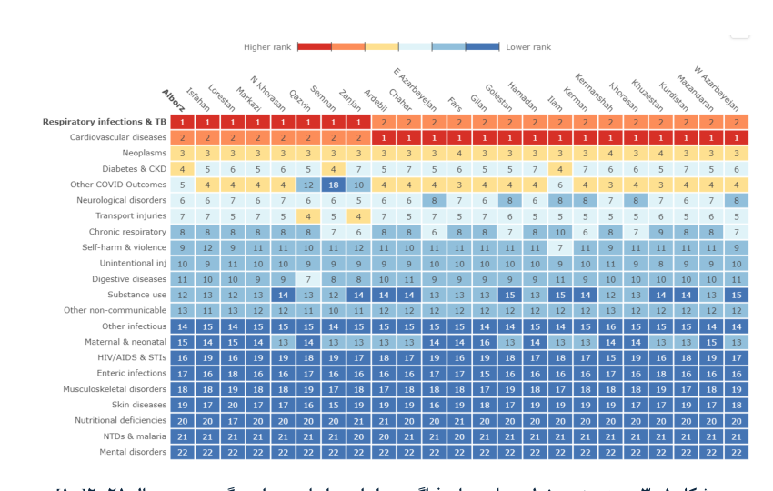
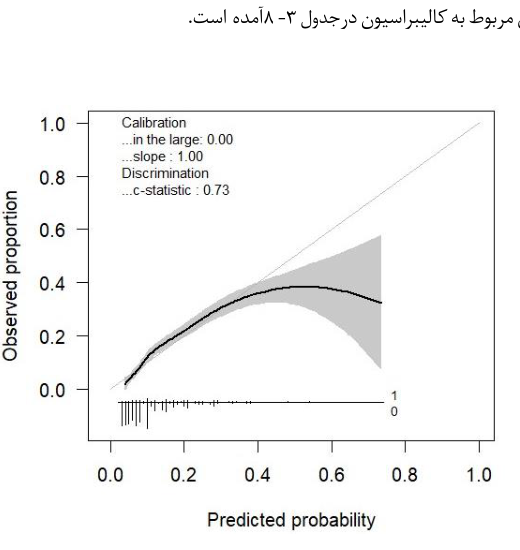
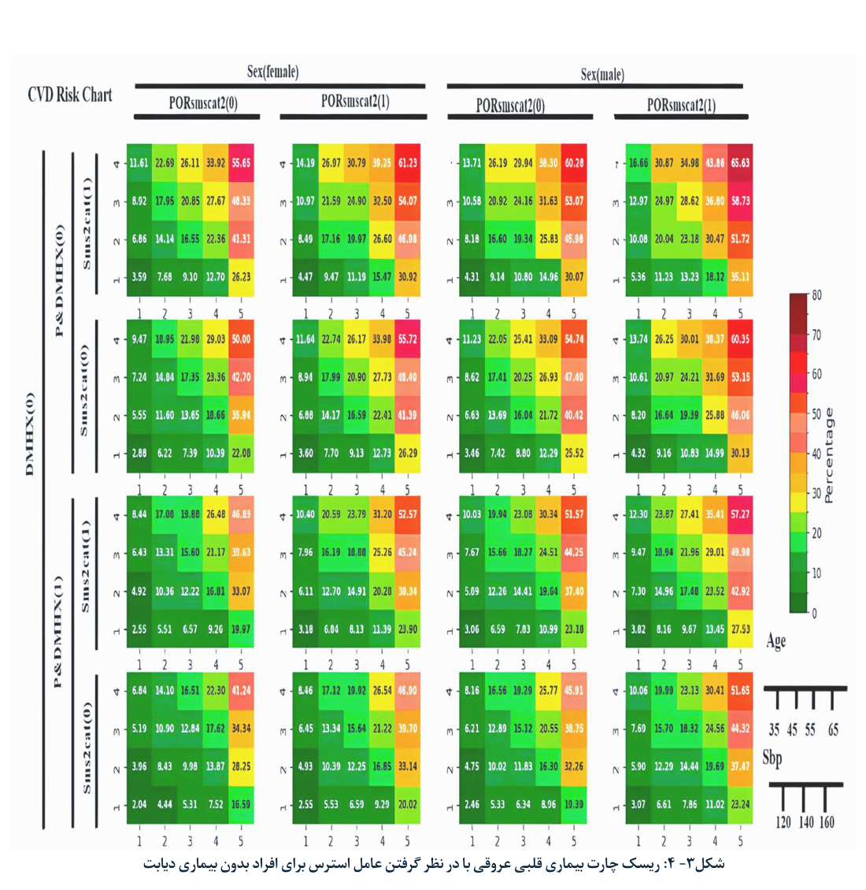

<div align="center">

# CVD Stress Risk Chart

### Logistic-regression modelling and risk-chart design for cardiovascular disease, considering psychological stress

**Research repository accompanying an undergraduate thesis in Biomedical Engineering**

[]()
[]()
[]()
[]()

</div>

> **Research-use notice.** This repository is intended for research reproducibility and educational purposes. It is not a clinically validated diagnostic tool, does not provide medical advice, and must not be used to make individual treatment decisions. The participant-level source data are not distributed with this repository.

---

## At a glance

This project investigates how psychological stress, alongside conventional cardiovascular risk factors, relates to cardiovascular disease (CVD). It documents the statistical workflow, logistic-regression model, model evaluation, and construction of a multi-panel risk chart.

The work is based on a thesis dataset combining information from the Isfahan Healthy Heart Program (IHHP) and psychological information derived from the PHQ-4 questionnaire.

| Item | Description |
|---|---|
| Research topic | Cardiovascular disease and psychological stress |
| Main outcome | Binary CVD outcome |
| Main modelling method | Logistic regression |
| Statistical tools | IBM SPSS Statistics 27, R 4.3.3, MATLAB R2023b, Python 3.12.4 |
| Risk-chart design | Enumeration of 640 model-input combinations |
| Source thesis | *Design of a Cardiovascular Risk Chart Considering Stress* |
| Author | Arezoo Pasand |
| Degree / field | B.Sc. thesis, Biomedical Engineering – Bioelectric |
| Institution | University of Isfahan, Faculty of Engineering |
| Supervisor | Dr. Hamidreza Marateb |
| Thesis date | September 2024 |

## Visual overview

The figures below are extracted from the original thesis document and included to make the research and its reported outputs easier to inspect. Figure captions are translated or shortened into English; the underlying figures have not been re-analysed or altered beyond cropping the page margins.

### 1. Research motivation and population context

The thesis introduces the public-health context of CVD and psychological stress using three background figures.

**Figure 1. Global comparison of years lived with disability associated with stress (2021).**  
*Source: thesis, Chapter 1, Figure 1-1, printed page 6.*


**Figure 2. CVD mortality trends across provinces/cities in Iran (1990–2021).**  
*Source: thesis, Chapter 1, Figure 1-2, printed page 6.*


**Figure 3. Ranking of major disease risks in Iran by mortality (2021).**  
*Source: thesis, Chapter 1, Figure 1-3, printed page 7.*



### 2. Model calibration and evaluation

The thesis reports calibration assessment before the selected variables are entered into the final logistic-regression model.

**Figure 4. Calibration plot.**  
The figure displays observed versus predicted proportions, together with the calibration intercept, slope, and discrimination statistic reported in the thesis.  
*Source: thesis, Chapter 3, Figure 3-1, printed page 31.*



**Figure 5. Confusion matrix reported in the thesis.**  
*Source: thesis, Chapter 3, Figure 3-2, printed page 34.*


**Figure 6. Receiver operating characteristic (ROC) curve.**  
The plotted legend in the thesis figure reports an area under the curve (AUC) of approximately 0.73. The thesis abstract and summary table report an AUC of 0.75; this difference is retained here as it appears in the source document and should be checked against the original analysis output.  
*Source: thesis, Chapter 3, Figure 3-3, printed page 35.*


### 3. CVD risk-chart visualizations

The thesis describes a risk chart built from the logistic-regression coefficients by evaluating 640 combinations of model inputs. The two panels below are the original thesis figures.

**Figure 7. CVD risk chart for profiles without diabetes, considering stress-related variables.**  
*Source: thesis, Chapter 3, Figure 3-4, printed page 37.*



**Figure 8. CVD risk chart for profiles with diabetes, considering stress-related variables.**  
*Source: thesis, Chapter 3, Figure 3-5, printed page 38.*


> **Interpretation caution:** The figures above are thesis figures, not newly generated clinical predictions. The source MATLAB appendix uses a zero intercept, while the SPSS constant needs to be verified before the model output can be interpreted as an absolute probability. The repository's generated chart script therefore labels the default output as a *model score*, not a calibrated clinical risk.

---

## Research question and motivation

Cardiovascular diseases are influenced by multiple interacting factors, including demographic, behavioural, physiological, and psychosocial variables. This thesis focuses on the possible contribution of psychological stress and asks whether stress-related variables, particularly in combination with diabetes and smoking, add useful information to a CVD risk-chart representation.

The reported analysis found that the stress variable alone was not statistically significant in the examined outcome. The thesis therefore explored logical combinations of stress with other variables, including diabetes and smoking, before selecting the final model inputs.

This is an observational analysis. The findings describe associations in the analysed dataset and do not establish that stress or any derived interaction causes CVD.

## Dataset and study context

The thesis describes data collected from adults in Arak, Isfahan, and Najafabad, Iran, through the Isfahan Healthy Heart Program, together with psychological information derived from PHQ-4.

The source document reports:
- An original population dataset of approximately 6,504 adults.
- A follow-up period described as up to 10 years in the methods chapter.
- Psychological stress information derived from the first two PHQ-4 questions.
- A final merged analysis dataset of 3,277 records in the methods/results chapters.

**Source-document discrepancy:** The thesis abstract reports 3,270 participants, whereas the methods and results chapters report 3,277 after merging and exclusions. This README uses 3,277 when describing the methods/results analysis, but the discrepancy should be checked against the final analysis dataset before formal publication.

The individual-level dataset is not included. The repository contains code and documentation only; it does not contain the participant records.

## Variables and model structure

The thesis describes the binary outcome as CVD status (`CVD5`), with 0 representing no CVD and 1 representing CVD.

The final model is described in the thesis through the following input terms:

- Age category (`Agec`)
- Systolic blood-pressure category (`sbp`)
- Sex (`sex`)
- Diabetes history (`DMHx`)
- Smoking (`sms2cat`)
- Stress–diabetes logical interaction (`pANDDMHX`)
- Stress–smoking logical combination (`pORsms2cat`)

The thesis reports five age categories and four systolic blood-pressure categories, alongside binary model terms. The exact coding and reference categories should be taken from the source SPSS model and the script documentation rather than inferred from the labels alone.

## Statistical analysis: methods, rationale, and sequence

This section expands the statistical workflow described in Chapters 2–3 and Appendices 1–7 of the thesis. It distinguishes the original thesis analysis from the scripts currently included in this repository; the latter are research-code implementations and should not automatically be assumed to reproduce every historical SPSS/R result bit-for-bit.

### 1. Data integration and analytical cohort

The source cohort data were combined with psychological information derived from the first two PHQ-4 questions, which were used to define the stress indicator (`PHQ2`). Appendix 1 uses Python and `pandas` to merge the two files through the common `IHHPCode` field. The thesis then describes excluding records with missing values for the analysis variables. The methods/results chapters report 3,277 complete records (2,882 without CVD and 395 with CVD); the abstract reports 3,270, and the model-evaluation section separately mentions 3,226 records. These sample-size differences are preserved as source-document discrepancies and should be reconciled against the original analysis files before publication.

### 2. Descriptive statistics and baseline comparison

The cohort was divided by the binary outcome `CVD5` (0 = no CVD; 1 = CVD). The descriptive table reports continuous variables using mean and standard deviation, median and range, and categorical variables using counts and percentages. P-values are displayed alongside the summaries.

The thesis reports, among other findings:

- Mean age was 48.4 years (SD 9.96) in the no-CVD group and 55.1 years (SD 10.7) in the CVD group (reported p < 0.001).
- Men represented 48.0% of the no-CVD group and 55.7% of the CVD group; the sex comparison was statistically significant (p = 0.00479).
- Diabetes was present in 5.2% of the no-CVD group and 15.7% of the CVD group (p < 0.001).
- The reported comparisons for systolic blood-pressure categories 2, 3, and 4 were statistically significant (p = 0.00332, < 0.001, and < 0.001, respectively).
- The reported comparisons for WHR categories 2–4 were not statistically significant (p = 0.912, 0.484, and 0.209); the stress indicator `PHQ2` alone was also not significant in this table (p = 0.665).

**Software:** R 4.3.3 / RStudio was used to create the descriptive table. Appendix 2 uses the R `table1` workflow and a custom `pvalue` function; Appendix 3 shows the R function used to calculate p-values. The thesis describes IBM SPSS Statistics 27.0 as the main statistical environment as well.

### 3. Distribution testing and selection of group-comparison tests

The Kolmogorov–Smirnov one-sample test was used to assess normality for continuous measures in the two outcome groups. The thesis reports p-values below 0.001 for Age and `FollowDu5th` in both groups, and consequently treats these distributions as non-normal. The Mann–Whitney U test was then reported for between-group comparisons:

| Variable | Mann–Whitney U | Z | Reported p-value |
|---|---:|---:|---:|
| Age | 360,458.0 | -11.844 | < 0.001 |
| FollowDu5th | 38,947.5 | -30.232 | < 0.001 |

The methods chapter also describes the independent-samples t-test as the parametric alternative when the relevant continuous data meet the normality assumption. For categorical variables, the thesis uses Pearson chi-square tests of independence, based on contingency tables, to assess association with the CVD outcome.

**Software:** The thesis reports SPSS 27.0 for the statistical testing and R for the descriptive-table/p-value workflow. The R appendix specifically shows `t.test()` for numeric variables and `chisq.test()` for categorical variables in its table-generation helper. The results chapter reports the Kolmogorov–Smirnov and Mann–Whitney outputs in SPSS-style tables.

### 4. Screening of categorical predictors and stress-related combinations

The chi-square analysis examined demographic, clinical, behavioural, and derived variables. In the reported table, sex (p = 0.004), diabetes (p < 0.001), smoking (p = 0.007), and systolic blood-pressure categories 2–4 (p = 0.003, < 0.001, and < 0.001) were statistically significant. WHR categories and stress alone were not significant in the same analysis; the stress-only p-value was 0.622 in the variable-significance table (the descriptive table reports 0.665).

Because stress alone was not statistically significant, the thesis constructed logical combinations of stress with other risk factors, including sex, diabetes, smoking, and systolic blood-pressure categories. The results chapter states that 32 derived variables were examined and 13 were statistically significant. Examples reported in the table include stress-by-sex (p = 0.040), stress/diabetes combinations (reported p < 0.001), and stress-by-systolic-pressure combinations (p-values from 0.048 to < 0.001, depending on category and operation). Some labels in the original table appear duplicated or typographically ambiguous; consult the original thesis table and variable-generation code before assigning a definitive interpretation to each row.

The significance criterion used in the methods is p < 0.05. Statistical significance is treated as a screening result, not as proof of causality or clinical importance.

### 5. Pairwise association and collinearity screening

After significance screening, pairwise associations were examined to reduce redundant information before modelling:

- **Phi coefficient (φ):** used for pairs of binary variables. Appendix 3 calculates the coefficient from a 2 × 2 contingency table and exports a matrix to Excel. The thesis uses |φ| ≥ 0.7 as the threshold for flagging strong association and considering removal of one of the correlated variables.
- **Biserial correlation:** used for the continuous variable Age against binary variables. Appendix 4 implements the calculation in Python using `numpy`, `pandas`, and `scipy.stats.norm`.

The thesis reports examples of age associations including Age–DMHx = 0.2266, Age–SBP category 3 = 0.3251, and Age–SBP category 4 = 0.3991. The displayed Phi matrix includes, for example, associations of 0.515952 between diabetes and `pANDDMHX`, and 0.589770 between smoking and `pORsms2cat`. The final candidate set described in the thesis includes sex, diabetes, smoking, the three systolic-pressure category indicators, the stress–diabetes logical product, and the stress–smoking logical combination.

**Software:** Python 3.12.4 was used for the Phi and biserial calculations in the appendices. The Phi script uses `pandas`, `scipy.stats.chi2_contingency`, and `openpyxl` to create and format the Excel correlation matrix. The biserial script uses `numpy`, `pandas`, and `scipy.stats.norm`.

### 6. Logistic-regression model

The outcome was binary CVD status (`CVD5`). The thesis reports fitting a multivariable logistic-regression model in IBM SPSS Statistics 27.0. The model terms include age category (`Agec`), systolic blood-pressure category (`sbp`), sex, diabetes history (`DMHx`), smoking (`sms2cat`), `pANDDMHX` (stress AND diabetes), and `pORsms2cat` (stress OR smoking). Categorical age and systolic-pressure variables expand into multiple indicator coefficients; therefore, the coefficient table contains more rows than the seven conceptual input variables.

The logistic model maps the linear predictor to an output through the sigmoid function:

`logit(p) = β0 + β1x1 + ... + βkxk`

`p = 1 / (1 + exp(-logit(p)))`

The thesis reports an 80%/20% training/test split in the model-evaluation description. It also mentions 3,226 records at this stage; this does not match the 3,277 records reported for the descriptive cohort and should be checked. The text refers to a 0.5 cut-off for the SPSS logistic model, while the Python evaluation appendix applies a 0.55 probability threshold; these are different analysis settings and are not interchangeable.

**Software:** SPSS 27.0 was used to fit the logistic regression and generate the model summary, Hosmer–Lemeshow test, coefficient estimates, standard errors, Wald statistics, p-values, odds ratios, and confidence intervals. MATLAB R2023b was used in Appendix 5 to implement the fitted logistic equation using the reported coefficients. The MATLAB function is a direct probability-function implementation; the source appendix sets the intercept to zero, so its output must not be interpreted as a verified absolute clinical risk until the original SPSS constant is confirmed.

### 7. Calibration and goodness of fit

Calibration was assessed in R before the final model was used for the risk-chart work. The thesis describes examining the calibration plot, intercept, and slope. It reports a calibration intercept close to zero and a slope of 1.00. The calibration table reports:

| Calibration statistic | Reported value |
|---|---:|
| Dxy | 0.4654881 |
| C-index / C_ROC | 0.732744 |
| R-squared | 0.1280431 |
| D | 0.06905938 |
| D Chi-square | 223.7855 |
| D p-value | 0 |
| U | -0.000619963 |
| U Chi-square | 0 |
| U p-value | 1 |
| Q | 0.06967934 |
| Brier score | 0.09944395 |
| Calibration intercept | 7.43 × 10⁻¹⁵ |
| Calibration slope | 1.00 |
| Emax | 1.21 × 10⁻¹⁴ |
| Eavg | 0.01727656 |
| ECI | 0.0701933 |

The SPSS model summary reports -2 Log Likelihood = 2156.427, Cox–Snell R² = 0.512, and Nagelkerke R² = 0.683. The Hosmer–Lemeshow statistic is 5.160 with 8 degrees of freedom and p = 0.740. These are distinct model-fit/calibration summaries and should not be conflated with classification accuracy or ROC-AUC.

**Software:** R 4.3.3 was used for the calibration analysis and plot, as stated in the thesis. The exact R package/function used for the calibration table is not identified in the thesis text, so no package name is asserted here.

### 8. Classification evaluation and threshold-dependent metrics

The thesis reports accuracy, precision, recall/sensitivity, F1-score, ROC-AUC, specificity, and Matthews correlation coefficient (MCC). It also reports five-fold cross-validation. The confusion-matrix discussion describes 990 actual negative cases and 140 actual positive cases in the test set: 779 negatives were correctly classified, 211 negatives were classified as positive, 75 positives were correctly classified, and 65 positives were classified as negative.

The thesis's results summary table reports the following values:

| Metric | Value in thesis summary table |
|---|---:|
| Accuracy | 0.74 |
| Precision | 0.23 |
| Recall / Sensitivity | 0.59 |
| F1-score | 0.33 |
| ROC-AUC | 0.75 |
| Specificity | 0.76 |
| MCC | 0.24 |
| Mean five-fold cross-validation score | 0.70 |

**Internal reporting differences in the thesis:** The prose accompanying the confusion matrix reports approximately 0.76 accuracy, 0.26 precision, 0.54 recall, and 0.35 F1; the ROC figure labels AUC = 0.73, whereas the summary table reports 0.75. The confusion-matrix counts (TN = 779, FP = 211, FN = 65, TP = 75) also imply values that do not exactly match every summary-table metric. This README preserves the source values and flags the differences rather than silently choosing one set. The original SPSS/Python output should be checked before these values are quoted in a paper or application.

**Software:** The original evaluation appendix is Python code using `pandas`, `numpy`, `scikit-learn`, `matplotlib`, and `imbalanced-learn` (SMOTE). It reads `6varcateg.xlsx`, selects the seven model inputs, drops missing rows, standardizes features, performs an 80/20 train/test split (`random_state=99`), applies SMOTE to the training data (`random_state=42`), and fits `LogisticRegression` with `C=10`, `class_weight='balanced'`, `solver='liblinear'`, and `max_iter=100`. The appendix uses a 0.55 threshold for class predictions and calculates five-fold cross-validation scores. The thesis also reports SPSS for the main logistic model. The current repository evaluation script has been revised separately; see its code comments and documentation for implementation differences from the original appendix.

### 9. Risk-chart construction

The thesis reports evaluating 640 combinations of the model-input profiles. The chart uses five age categories, four systolic blood-pressure categories, and 32 binary-condition profiles (5 binary inputs, 2⁵ = 32); each profile is displayed across the age-by-pressure grid. The heatmap colours progress from green toward red as the model output increases. The thesis presents separate risk-chart figures for people with and without diabetes and discusses the combined patterns of stress, smoking, diabetes, age, and systolic blood pressure.

Appendix 7 implements the original charting workflow in Python using `pandas`, `numpy`, `matplotlib`, `seaborn`, and `matplotlib.colors`. It reads the locally prepared `final data.xlsx`, filters records by the 32 listed condition profiles, fills a 4 × 5 age/pressure matrix, and plots the heatmaps. MATLAB R2023b is used for the logistic function in Appendix 5; Python is used for the Appendix 7 chart visualisation. These are separate stages.

**Interpretation caution:** the source chart code uses derived logical variables (`pANDDMHX`, `pORsms2cat`) alongside their underlying variables. The logical definitions and all profile combinations should be checked against the original data-generation code before treating every cell as a realizable participant profile. Also verify the SPSS intercept before calling chart values absolute probabilities.

### Software by analysis stage

| Software / version reported | Role in the thesis | Relevant appendix / output |
|---|---|---|
| IBM SPSS Statistics 27.0 | Main statistical analysis; chi-square tests; logistic-regression fitting; model summary, Hosmer–Lemeshow test, coefficients and odds ratios | Chapter 3, Tables 3-5 and 3-9 to 3-12 |
| R 4.3.3 / RStudio | Descriptive statistics table, p-value helper functions, and calibration assessment/plot | Appendices 2–3; Chapter 3, Figure 3-1 and Table 3-8 |
| Python 3.12.4 | Dataset merging; Phi and biserial association scripts; model evaluation and metric/curve generation; risk-chart heatmaps | Appendices 1, 3, 4, 6, and 7 |
| MATLAB R2023b | Implementation of the logistic probability function using the reported beta coefficients | Appendix 5 |

The Python and R packages listed above are taken from the appendix code. The thesis does not identify every package used for every stage; unspecified package names are intentionally not guessed.

## Reported thesis results

The following values are transcribed from the thesis abstract/results summary. They are **reported thesis metrics**, not a claim that every script in this repository reproduces the original SPSS analysis exactly.

| Metric | Value reported in thesis |
|---|---:|
| Accuracy | 0.74 |
| Precision | 0.23 |
| Recall / Sensitivity | 0.59 |
| F1-score | 0.33 |
| AUC | 0.75 |
| Specificity | 0.76 |
| Matthews correlation coefficient (MCC) | 0.24 |
| Mean five-fold cross-validation score | 0.70 |

The reported cohort is imbalanced, with fewer CVD-positive than CVD-negative observations. Accuracy should therefore be interpreted together with sensitivity, precision, specificity, F1-score, and MCC.

### Logistic-regression coefficients reported in the thesis

| Model term | B | S.E. | Wald | p-value | Exp(B) / OR | 95% CI for OR |
|---|---:|---:|---:|---:|---:|---:|
| Agec(1) | -2.257 | 0.207 | 118.344 | <0.001 | 0.105 | 0.070–0.157 |
| Agec(2) | -1.453 | 0.190 | 58.433 | <0.001 | 0.234 | 0.161–0.339 |
| Agec(3) | -1.267 | 0.186 | 46.269 | <0.001 | 0.282 | 0.195–0.406 |
| Agec(4) | -0.894 | 0.210 | 18.163 | <0.001 | 0.409 | 0.271–0.617 |
| DMHx | 1.045 | 0.201 | 26.971 | <0.001 | 2.843 | 1.917–4.218 |
| sms2cat | 0.227 | 0.177 | 1.645 | 0.200 | 1.255 | 0.887–1.777 |
| pANDDMHX | -0.354 | 0.378 | 0.878 | 0.349 | 0.702 | 0.335–1.472 |
| pORsms2cat | 0.230 | 0.147 | 2.457 | 0.117 | 1.259 | 0.944–1.679 |
| sbp(1) | -1.261 | 0.194 | 42.182 | <0.001 | 0.283 | 0.194–0.415 |
| sbp(2) | -0.578 | 0.177 | 10.695 | 0.001 | 0.561 | 0.397–0.793 |
| sbp(3) | -0.294 | 0.201 | 2.144 | 0.143 | 0.745 | 0.503–1.105 |
| sex(1) | 0.190 | 0.125 | 2.308 | 0.129 | 1.210 | 0.946–1.546 |

The omnibus age-category effect is reported as Wald = 125.414 (df = 4, p < 0.001); the omnibus systolic-pressure-category effect is Wald = 52.599 (df = 3, p < 0.001). `Agec(5)` and `sbp(4)` are the reference categories. ORs are odds ratios, not risk ratios or direct percentage changes in probability. For example, the reported OR of 2.843 for diabetes means 2.843 times the odds relative to the model's reference coding, conditional on the other model terms; it does not mean a 2.843-fold absolute probability. Several individual terms (smoking, the two derived stress terms, SBP category 3, and sex) have p-values above 0.05 in this coefficient table, even though the thesis discusses their screening/combined-variable roles elsewhere. The reported Hosmer–Lemeshow test significance is 0.740.

---

## Repository structure

```text
cvd-stress-risk-chart/
├── README.md
├── LICENSE
├── requirements.txt
├── .gitignore
├── data/
│   ├── README.md
│   └── .gitkeep
├── docs/
│   ├── GITHUB_GUIDE.md
│   └── figures/
│       ├── 01_stress_disability_global_map.png
│       ├── 02_cvd_mortality_iran_trends.png
│       ├── 03_disease_risk_rank_iran.png
│       ├── 04_model_calibration.png
│       ├── 05_confusion_matrix_thesis.png
│       ├── 06_roc_curve_thesis.png
│       ├── 07_risk_chart_without_diabetes.png
│       └── 08_risk_chart_with_diabetes.png
├── results/
│   ├── README.md
│   ├── risk_chart_diabetes_model_score.png
│   └── risk_chart_no_diabetes_model_score.png
└── src/
    ├── 01_merge_data.py
    ├── 02_descriptive_table.R
    ├── 03_phi_correlation.py
    ├── 04_biserial_correlation.py
    ├── 05_logistic_function.m
    ├── 06_model_evaluation.py
    └── 07_risk_chart.py
```

## Code map

| Script | Purpose |
|---|---|
| `01_merge_data.py` | Merge the cohort data with PHQ-4-derived data |
| `02_descriptive_table.R` | Produce descriptive statistics and group summaries |
| `03_phi_correlation.py` | Calculate Phi associations between binary variables |
| `04_biserial_correlation.py` | Examine continuous–binary associations |
| `05_logistic_function.m` | Implement the logistic probability function using thesis coefficients |
| `06_model_evaluation.py` | Run the repository's evaluation workflow and generate evaluation outputs |
| `07_risk_chart.py` | Enumerate model-input combinations and generate risk-chart figures |

These scripts document components of the analysis. They are not guaranteed to form a fully automated end-to-end pipeline without the private source data and intermediate files.

## Reproducibility and execution

### Software environment

The thesis reports IBM SPSS Statistics 27.0, R 4.3.3 / RStudio, MATLAB R2023b, and Python 3.12.4. The stage-by-stage responsibilities and appendix references are documented in [Software by analysis stage](#software-by-analysis-stage) above. The Python scripts in this repository may require the packages listed in `requirements.txt`; R and MATLAB scripts require their respective local environments.

### Set up Python

```bash
python -m venv .venv
```

Activate the environment:

```bash
# Windows PowerShell
.venv\Scripts\Activate.ps1

# macOS / Linux
source .venv/bin/activate
```

Install dependencies:

```bash
python -m pip install --upgrade pip
pip install -r requirements.txt
```

### Generate the repository's model-score risk charts

```bash
python src/07_risk_chart.py
```

The script writes:

```text
results/risk_chart_diabetes_model_score.png
results/risk_chart_no_diabetes_model_score.png
```

These repository-generated figures are separate from the original thesis figures in `docs/figures/`.

### Run model evaluation

Place the required local intermediate workbook at `data/6varcateg.xlsx` and run:

```bash
python src/06_model_evaluation.py data/6varcateg.xlsx
```

The script generates evaluation outputs such as ROC, precision–recall, confusion-matrix figures, and a metrics summary. Exact outputs depend on the local input data and software environment.

### Run the other analysis components

The remaining scripts require local source/intermediate files described in `data/README.md`.

```bash
python src/01_merge_data.py
Rscript src/02_descriptive_table.R
python src/03_phi_correlation.py data/final_data.xlsx
python src/04_biserial_correlation.py data/final_data.xlsx
```

Run the MATLAB function from MATLAB after preparing the input matrix in the column order documented in the function header.

## Important methodological and interpretation notes

### 640 risk-chart combinations

The thesis describes 640 combinations. The chart script enumerates:

- 5 age categories;
- 4 systolic blood-pressure categories;
- 32 combinations of five binary model inputs.

Therefore, 5 × 4 × 32 = 640 model-output cells.

The thesis also describes `pANDDMHX` and `pORsms2cat` as derived logical variables. Enumerating them independently may include combinations that are not logically realizable given their source variables. The original Appendix 7 generation rules should be checked before interpreting every cell as a possible participant profile.

### Intercept and absolute-risk interpretation

The source MATLAB appendix uses an intercept of zero, while the SPSS constant should be verified from the original SPSS output. The repository's chart script labels default outputs as model scores. Do not interpret them as calibrated absolute probabilities unless the intercept, coding, and calibration have been verified.

If the SPSS constant has been verified, configure it using the instructions in `docs/GITHUB_GUIDE.md` or the script comments. Do not substitute an estimated or guessed value.

### Evaluation implementation

The revised Python evaluation script uses a pipeline that places preprocessing and SMOTE within the training process. Its output may differ from the thesis-reported metrics, which were generated in the original analysis environment. The repository's reanalysis should not be described as an exact reproduction unless the same data split, coding, coefficients, and evaluation protocol have been independently matched.

## Limitations

- The analysis uses data from a specific population and geographic setting in central Iran.
- The thesis reports a discrepancy in the final sample count between its abstract and methods/results sections; this needs source-data verification.
- The reported ROC AUC differs between the plotted ROC figure (approximately 0.73) and the abstract/results summary (0.75).
- The calibration and intercept must be checked against the original statistical output.
- Derived logical variables in the risk chart may impose constraints on valid combinations.
- External validation in an independent population is required before clinical interpretation.
- The model should not be used as a diagnostic or treatment decision tool.

## Data privacy and responsible sharing

- Do not upload raw or participant-level datasets.
- Do not upload identifiers, dates of birth, contact details, or potentially re-identifiable records.
- Confirm that sharing thesis figures and aggregate outputs is permitted by applicable institutional, ethics, and data-use requirements.
- Review every staged file before committing. `.gitignore` does not remove files that have already been committed.
- Keep the repository private unless and until you have confirmed that all code, figures, and documentation may be shared publicly.

## Citation

Pasand, A. (2024). *Design of a Cardiovascular Risk Chart Considering Stress*. B.Sc. thesis, Biomedical Engineering (Bioelectric), Faculty of Engineering, University of Isfahan. Supervisor: Dr. Hamidreza Marateb.

## Acknowledgement

The author gratefully acknowledges the thesis supervisor, Dr. Hamidreza Marateb, for research guidance.

---

<div align="center">

**A research implementation for statistical analysis, logistic-regression modelling, and cardiovascular risk-chart visualization.**

</div>
