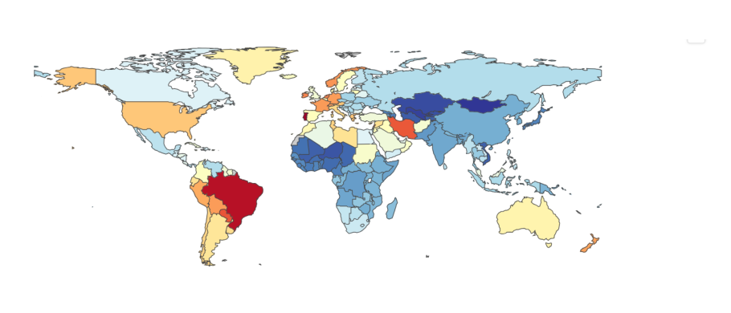
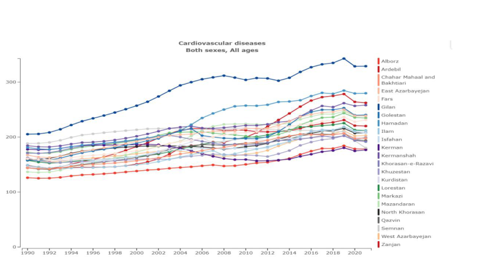

<div align="center">

# CVD Stress Risk Chart

### Logistic-regression modelling and risk-chart design for cardiovascular disease, considering psychological stress

**Research repository accompanying a B.Sc. thesis in Biomedical Engineering**

[]()
[]()
[]()
[]()
[]()

</div>

> **Research-use notice.** This repository documents a thesis-based statistical analysis and risk-chart implementation. It is intended for research and educational purposes only. It is not a clinically validated diagnostic tool, does not provide medical advice, and must not be used for individual treatment decisions. Participant-level source data are not distributed with this repository.

---

## Project overview

This project investigates the relationship between cardiovascular disease (CVD), conventional cardiovascular risk factors, and psychological stress. It documents the preparation of the analytical dataset, descriptive and inferential statistical analyses, association screening, multivariable logistic regression, model evaluation, and the construction of a multi-panel risk chart.

The thesis dataset combines information from the Isfahan Healthy Heart Program (IHHP) with psychological information derived from the PHQ-4 questionnaire. The main outcome is binary CVD status.

| Project component | Description |
|---|---|
| Research topic | Cardiovascular disease and psychological stress |
| Outcome | Binary CVD status (`CVD5`) |
| Main modelling method | Multivariable logistic regression |
| Main statistical software | IBM SPSS Statistics 27.0 |
| Additional software | R 4.3.3 / RStudio, Python 3.12.4, MATLAB R2023b |
| Risk-chart design | 5 age categories × 4 systolic blood-pressure categories × 32 binary profiles = 640 model-input combinations |
| Thesis author | Arezoo Pasand |
| Degree / field | B.Sc. thesis, Biomedical Engineering – Bioelectric |
| Institution | University of Isfahan, Faculty of Engineering |
| Supervisor | Dr. Hamidreza Marateb |
| Thesis date | September 2024 |

## Research question and motivation

Cardiovascular diseases are influenced by demographic, behavioural, physiological, and psychosocial factors. This thesis focuses on the possible contribution of psychological stress alongside conventional cardiovascular risk factors, and explores whether stress-related combinations with factors such as diabetes and smoking can be represented in a CVD risk-chart framework.

The thesis reports that the stress indicator alone was not statistically significant in the examined outcome. It therefore explores logical combinations of stress with other variables, including sex, diabetes, smoking, and systolic blood-pressure categories.

This is an observational analysis. The reported findings describe associations in the analysed dataset and do not establish that stress or any derived interaction causes CVD.

### Epidemiological context from the thesis

The following figures are placed in the background section because they introduce the public-health context of the research. Each image is cited to its original thesis figure and printed page.

**Figure 1. Global comparison of years lived with disability associated with stress (2021).**  
*Source: Pasand (2024), Chapter 1, Figure 1-1, printed page 6. Image reproduced from the thesis; file: `docs/figures/01_stress_disability_global_map.png`.*



**Figure 2. CVD mortality trends across provinces/cities in Iran (1990–2021).**  
*Source: Pasand (2024), Chapter 1, Figure 1-2, printed page 6. Image reproduced from the thesis; file: `docs/figures/02_cvd_mortality_iran_trends.png`.*



**Figure 3. Ranking of major disease risks in Iran by mortality (2021).**  
*Source: Pasand (2024), Chapter 1, Figure 1-3, printed page 7. Image reproduced from the thesis; file: `docs/figures/03_disease_risk_rank_iran.png`.*


## Dataset and study context

The thesis describes data collected from adults in Arak, Isfahan, and Najafabad, Iran, through the Isfahan Healthy Heart Program, together with psychological information derived from the first two PHQ-4 questions.

The source thesis reports:
- An original population dataset of approximately 6,504 adults.
- A follow-up period described in the methods chapter as up to 10 years.
- Psychological stress information derived from the first two PHQ-4 questions.
- A final merged analytical dataset of 3,277 records in the methods/results chapters.

**Sample-size discrepancy in the source thesis:** the abstract reports 3,270 participants, whereas the methods and results chapters report 3,277 after merging and exclusions. The model-evaluation section separately mentions 3,226 records. These figures are retained as reported and should be reconciled against the original analysis files before formal publication.

The participant-level dataset is not included in this repository. Raw data, identifiers, and individual-level records must remain outside the public repository.

## Variables and model structure

The thesis describes the binary outcome as CVD status (`CVD5`), with 0 representing no CVD and 1 representing CVD.

The final model is described using the following terms:

| Variable | Description in the thesis |
|---|---|
| `CVD5` | Binary CVD outcome |
| `Agec` | Age category (five categories) |
| `sbp` | Systolic blood-pressure category (four categories) |
| `sex` | Sex |
| `DMHx` | Diabetes history |
| `sms2cat` | Smoking category |
| `pANDDMHX` | Stress AND diabetes logical combination |
| `pORsms2cat` | Stress OR smoking logical combination |

The exact coding, reference categories, and derivation rules should be taken from the source analysis files and thesis appendices. They should not be inferred from variable names alone.

---

## Statistical analysis workflow

This section follows the analysis stages described in Chapters 2–3 and Appendices 1–7 of the thesis. It distinguishes the original thesis analysis from the repository scripts: the scripts document and implement analysis components, but they should not automatically be assumed to reproduce every historical SPSS/R result exactly.

### 1. Data integration and analytical cohort

The source cohort data were combined with psychological information derived from the first two PHQ-4 questions, used to define the stress indicator (`PHQ2`). Appendix 1 uses Python and `pandas` to merge the files through the common `IHHPCode` field. The thesis then describes excluding records with missing values for the analysis variables.

The methods/results chapters report 3,277 complete records (2,882 without CVD and 395 with CVD). The abstract reports 3,270, while the model-evaluation section separately mentions 3,226 records. These discrepancies should be checked against the original data-processing log before publication.

**Software and implementation**
- **Python 3.12.4:** data merging using `pandas`.
- **Input:** locally stored IHHP and PHQ-4-derived files.
- **Output:** an analysis-ready merged dataset. The individual-level input files are not included in this repository.

### 2. Descriptive statistics and baseline comparison

The analytical cohort was described according to the binary outcome `CVD5` (0 = no CVD; 1 = CVD). The thesis presents continuous variables using descriptive summaries such as mean and standard deviation, median and range, and categorical variables using counts and percentages. P-values are reported alongside group summaries.

Examples reported in the thesis include:

| Variable / comparison | No-CVD group | CVD group | Reported p-value |
|---|---:|---:|---:|
| Mean age | 48.4 years (SD 9.96) | 55.1 years (SD 10.7) | < 0.001 |
| Men | 48.0% | 55.7% | 0.00479 |
| Diabetes | 5.2% | 15.7% | < 0.001 |
| WHR category 2 | — | — | 0.912 |
| WHR category 3 | — | — | 0.484 |
| WHR category 4 | — | — | 0.209 |
| Stress indicator (`PHQ2`) | — | — | 0.665 |

The thesis reports statistically significant group differences for age, sex, diabetes, and several systolic blood-pressure categories. WHR category comparisons and the stress indicator alone were not statistically significant in the cited descriptive table.

**Software and implementation**
- **R 4.3.3 / RStudio:** descriptive table generation.
- **R workflow:** Appendix 2 uses the `table1` workflow and a custom `pvalue` function; Appendix 3 shows the R function used to calculate p-values.
- **IBM SPSS Statistics 27.0:** identified in the thesis as the main statistical environment for the statistical analyses.

### 3. Distribution testing and selection of group-comparison tests

The Kolmogorov–Smirnov one-sample test was used to assess normality for continuous measures in the two outcome groups. The thesis reports p-values below 0.001 for Age and `FollowDu5th` in both groups and consequently treats these distributions as non-normal.

The Mann–Whitney U test was then reported for between-group comparisons:

| Variable | Mann–Whitney U | Z | Reported p-value |
|---|---:|---:|---:|
| Age | 360,458.0 | -11.844 | < 0.001 |
| FollowDu5th | 38,947.5 | -30.232 | < 0.001 |

The methods chapter also describes the independent-samples t-test as the parametric alternative when the relevant continuous data meet the normality assumption. For categorical variables, Pearson's chi-square test of independence is used to assess association with the CVD outcome through contingency tables.

**Software and implementation**
- **IBM SPSS Statistics 27.0:** statistical testing and reported Kolmogorov–Smirnov and Mann–Whitney outputs.
- **R 4.3.3 / RStudio:** the descriptive-table helper in the R appendix shows `t.test()` for numeric variables and `chisq.test()` for categorical variables. The exact test used for a particular comparison should be read from the corresponding thesis result table.

### 4. Categorical-variable screening and stress-related combinations

The chi-square analysis examined demographic, clinical, behavioural, and derived variables. In the reported variable-significance table, sex (p = 0.004), diabetes (p < 0.001), smoking (p = 0.007), and systolic blood-pressure categories 2–4 (p = 0.003, < 0.001, and < 0.001) were statistically significant. WHR categories and stress alone were not significant in the same analysis; the stress-only p-value is reported as 0.622 in the variable-significance table, while the descriptive table reports 0.665.

Because stress alone was not statistically significant, the thesis examined logical combinations of stress with other risk factors, including sex, diabetes, smoking, and systolic blood-pressure categories. The results chapter states that 32 derived variables were examined and 13 were statistically significant. Examples include stress-by-sex (p = 0.040), stress/diabetes combinations (reported p < 0.001), and stress-by-systolic-pressure combinations (reported p-values ranging from 0.048 to < 0.001, depending on the category and logical operation).

Some labels in the original table appear duplicated or typographically ambiguous. The exact meaning of each derived variable should therefore be verified against the original variable-generation code and thesis table before being assigned a definitive interpretation.

The significance criterion described in the methods is p < 0.05. Statistical significance is treated as a screening result, not proof of causality or clinical importance.

**Software and implementation**
- **IBM SPSS Statistics 27.0:** main statistical testing reported in the thesis.
- **Python 3.12.4:** preparation and manipulation of derived variables in the associated scripts, where applicable.

### 5. Pairwise association and collinearity screening

After significance screening, pairwise associations were examined to identify redundant information before modelling.

**Phi coefficient (φ)**  
The Phi coefficient was used for pairs of binary variables. Appendix 3 calculates the coefficient from a 2 × 2 contingency table and exports a matrix to Excel. The thesis uses |φ| ≥ 0.7 as the threshold for flagging strong association and considering removal of one of the correlated variables.

**Biserial correlation**  
Biserial correlation was used to examine associations between the continuous variable Age and binary variables. Appendix 4 implements the calculation in Python using `numpy`, `pandas`, and `scipy.stats.norm`.

Examples reported in the thesis include:

| Pair of variables | Reported association |
|---|---:|
| Age – DMHx | 0.2266 |
| Age – SBP category 3 | 0.3251 |
| Age – SBP category 4 | 0.3991 |
| Diabetes – `pANDDMHX` (Phi matrix) | 0.515952 |
| Smoking – `pORsms2cat` (Phi matrix) | 0.589770 |

The final candidate set described in the thesis includes sex, diabetes, smoking, systolic-pressure category indicators, the stress–diabetes logical product, and the stress–smoking logical combination.

**Software and implementation**
- **Python 3.12.4**
- **Libraries:** `numpy`, `pandas`, `scipy.stats`, and `openpyxl` for the Phi matrix and Excel output.
- **Appendices:** Appendix 3 (Phi coefficient) and Appendix 4 (biserial correlation).

### 6. Multivariable logistic-regression model

The outcome was binary CVD status (`CVD5`). The thesis reports fitting a multivariable logistic-regression model in IBM SPSS Statistics 27.0. The model terms include age category (`Agec`), systolic blood-pressure category (`sbp`), sex, diabetes history (`DMHx`), smoking (`sms2cat`), `pANDDMHX` (stress AND diabetes), and `pORsms2cat` (stress OR smoking).

The logistic model maps the linear predictor to an output through the sigmoid function:

\[
\operatorname{logit}(p) = \beta_0 + \beta_1x_1 + \cdots + \beta_kx_k
\]

\[
p = \frac{1}{1+\exp[-(\beta_0+\beta_1x_1+\cdots+\beta_kx_k)]}
\]

The thesis reports an 80%/20% training/test split in the model-evaluation description. It also mentions 3,226 records at this stage, which differs from the 3,277 records reported for the descriptive cohort. The text refers to a 0.5 cut-off for the SPSS logistic model, while the Python evaluation appendix applies a 0.55 probability threshold. These settings are not interchangeable.

**Software and implementation**
- **IBM SPSS Statistics 27.0:** fitting the main logistic-regression model and producing the model summary, coefficient estimates, standard errors, Wald statistics, p-values, odds ratios, and confidence intervals.
- **MATLAB R2023b:** Appendix 5 implements the logistic function using the reported beta coefficients.
- The source MATLAB appendix sets the intercept to zero. The SPSS constant must be verified before the MATLAB function can be treated as a reproduction of the fitted model's absolute probabilities.

### 7. Model coefficients and odds ratios

The thesis reports the following coefficient table. The odds ratios (Exp(B)) represent odds relative to the model's reference coding, conditional on the other terms; they are not risk ratios or direct percentage changes in probability.

| Model term | B | S.E. | Wald | p-value | Exp(B) / OR | 95% CI for OR |
|---|---:|---:|---:|---:|---:|---:|
| Agec(1) | -2.257 | 0.207 | 118.344 | <0.001 | 0.105 | 0.070–0.157 |
| Agec(2) | -1.453 | 0.190 | 58.433 | <0.001 | 0.234 | 0.161–0.339 |
| Agec(3) | -1.267 | 0.186 | 46.269 | <0.001 | 0.282 | 0.195–0.406 |
| Agec(4) | -0.894 | 0.210 | 18.163 | <0.001 | 0.409 | 0.271–0.617 |
| DMHx | 1.045 | 0.201 | 26.971 | <0.001 | 2.843 | 1.917–4.218 |
| sms2cat | 0.227 | 0.177 | 1.645 | 0.200 | 1.255 | 0.887–1.777 |
| pANDDMHX | -0.354 | 0.378 | 0.878 | 0.349 | 0.702 | 0.335–1.472 |
| pORsms2cat | 0.230 | 0.147 | 2.457 | 0.117 | 1.259 | 0.944–1.679 |
| sbp(1) | -1.261 | 0.194 | 42.182 | <0.001 | 0.283 | 0.194–0.415 |
| sbp(2) | -0.578 | 0.177 | 10.695 | 0.001 | 0.561 | 0.397–0.793 |
| sbp(3) | -0.294 | 0.201 | 2.144 | 0.143 | 0.745 | 0.503–1.105 |
| sex(1) | 0.190 | 0.125 | 2.308 | 0.129 | 1.210 | 0.946–1.546 |

The omnibus age-category effect is reported as Wald = 125.414 (df = 4, p < 0.001); the omnibus systolic-pressure-category effect is Wald = 52.599 (df = 3, p < 0.001). `Agec(5)` and `sbp(4)` are the reference categories.

Several individual terms in this coefficient table (smoking, the two derived stress terms, SBP category 3, and sex) have p-values above 0.05. These coefficient-level results should be distinguished from the earlier screening of derived variables.

### 8. Calibration and goodness of fit

Calibration was assessed in R before the final model was used for the risk-chart work. The thesis describes examining the calibration plot, intercept, and slope. It reports a calibration intercept close to zero and a slope of 1.00.

The calibration table reports:

| Calibration statistic | Reported value |
|---|---:|
| Dxy | 0.4654881 |
| C-index / C_ROC | 0.732744 |
| R-squared | 0.1280431 |
| D | 0.06905938 |
| D Chi-square | 223.7855 |
| D p-value | 0 |
| U | -0.000619963 |
| U Chi-square | 0 |
| U p-value | 1 |
| Q | 0.06967934 |
| Brier score | 0.09944395 |
| Calibration intercept | 7.43 × 10⁻¹⁵ |
| Calibration slope | 1.00 |
| Emax | 1.21 × 10⁻¹⁴ |
| Eavg | 0.01727656 |
| ECI | 0.0701933 |

The SPSS model summary reports -2 Log Likelihood = 2156.427, Cox–Snell R² = 0.512, and Nagelkerke R² = 0.683. The Hosmer–Lemeshow statistic is 5.160 with 8 degrees of freedom and p = 0.740. These are distinct model-fit and calibration summaries; they should not be conflated with classification accuracy or ROC-AUC.

**Figure 4. Calibration plot reported in the thesis.**  
The plot presents observed versus predicted proportions and the calibration information discussed above.  
*Source: Pasand (2024), Chapter 3, Figure 3-1, printed page 31. Image reproduced from the thesis; file: `docs/figures/04_model_calibration.png`.*


**Software and implementation**
- **R 4.3.3 / RStudio:** calibration analysis and plot, as reported in the thesis.
- The exact R package/function used for the calibration table is not identified in the thesis text; no package name is asserted here.
- **IBM SPSS Statistics 27.0:** model summary and Hosmer–Lemeshow output.

### 9. Classification performance and threshold-dependent metrics

The thesis reports accuracy, precision, recall/sensitivity, F1-score, ROC-AUC, specificity, and Matthews correlation coefficient (MCC). It also reports five-fold cross-validation.

The confusion-matrix discussion describes 990 actual negative cases and 140 actual positive cases in the test set:
- True negatives (TN) = 779
- False positives (FP) = 211
- False negatives (FN) = 65
- True positives (TP) = 75

The thesis summary table reports:

| Metric | Value reported in thesis summary |
|---|---:|
| Accuracy | 0.74 |
| Precision | 0.23 |
| Recall / Sensitivity | 0.59 |
| F1-score | 0.33 |
| ROC-AUC | 0.75 |
| Specificity | 0.76 |
| Matthews correlation coefficient (MCC) | 0.24 |
| Mean five-fold cross-validation score | 0.70 |

**Figure 5. Confusion matrix reported in the thesis.**  
The matrix visualises the classification counts described in the thesis text.  
*Source: Pasand (2024), Chapter 3, Figure 3-2, printed page 34. Image reproduced from the thesis; file: `docs/figures/05_confusion_matrix_thesis.png`.*


**Figure 6. Receiver operating characteristic (ROC) curve reported in the thesis.**  
The plotted legend reports an AUC of approximately 0.73, whereas the thesis abstract and summary table report 0.75. This discrepancy is retained rather than silently choosing one value.  
*Source: Pasand (2024), Chapter 3, Figure 3-3, printed page 35. Image reproduced from the thesis; file: `docs/figures/06_roc_curve_thesis.png`.*


**Internal reporting differences in the thesis:** the prose accompanying the confusion matrix reports approximately 0.76 accuracy, 0.26 precision, 0.54 recall, and 0.35 F1. The ROC figure labels AUC ≈ 0.73, while the summary table reports 0.75. The confusion-matrix counts (TN = 779, FP = 211, FN = 65, TP = 75) also do not reproduce every value in the summary table exactly. The original SPSS/Python output should be checked before these metrics are quoted in a paper or application.

**Software and implementation**
- **Python 3.12.4:** the original evaluation appendix uses `pandas`, `numpy`, `scikit-learn`, `matplotlib`, and `imbalanced-learn` (SMOTE).
- The appendix reads `6varcateg.xlsx`, selects the model inputs, drops missing rows, standardizes features, performs an 80/20 train/test split (`random_state=99`), applies SMOTE to the training data (`random_state=42`), and fits `LogisticRegression` with `C=10`, `class_weight='balanced'`, `solver='liblinear'`, and `max_iter=100`.
- The original appendix uses a 0.55 threshold for class predictions and calculates five-fold cross-validation scores.
- The thesis also reports SPSS for the main logistic-regression model. The current repository evaluation script is a separate implementation; consult its comments for differences from the original appendix.

### 10. Risk-chart construction

The thesis reports evaluating 640 combinations of model-input profiles. The chart construction is described as:

- 5 age categories;
- 4 systolic blood-pressure categories;
- 32 combinations of five binary inputs.

Thus, 5 × 4 × 32 = 640 model-output cells.

The thesis presents separate risk-chart figures for profiles with and without diabetes and discusses patterns involving stress, smoking, diabetes, age, and systolic blood pressure.

**Figure 7. Thesis CVD risk chart for profiles without diabetes, considering stress-related variables.**  
*Source: Pasand (2024), Chapter 3, Figure 3-4, printed page 37. Image reproduced from the thesis; file: `docs/figures/07_risk_chart_without_diabetes.png`.*


**Figure 8. Thesis CVD risk chart for profiles with diabetes, considering stress-related variables.**  
*Source: Pasand (2024), Chapter 3, Figure 3-5, printed page 38. Image reproduced from the thesis; file: `docs/figures/08_risk_chart_with_diabetes.png`.*


Appendix 7 implements the original charting workflow in Python using `pandas`, `numpy`, `matplotlib`, `seaborn`, and `matplotlib.colors`. It reads a locally prepared `final data.xlsx`, filters records by the listed condition profiles, fills a 4 × 5 age/pressure matrix, and plots heatmaps. MATLAB R2023b is used for the logistic function in Appendix 5; Python is used for the Appendix 7 chart visualisation. These are separate stages.

**Important interpretation note:** the thesis describes `pANDDMHX` and `pORsms2cat` as derived logical variables. Enumerating these independently may include combinations that are not logically realizable given their source variables. The original Appendix 7 generation rules should be checked before interpreting every cell as a possible participant profile.

**Intercept and absolute-risk caution:** the source MATLAB appendix uses an intercept of zero, while the SPSS constant needs to be verified. The repository-generated chart script labels its default outputs as *model scores*. Do not interpret these outputs as calibrated absolute probabilities unless the intercept, variable coding, and calibration have been verified.

## Software used by analysis stage

The table below summarises the software roles described in the thesis and appendices. Where the thesis does not identify an exact package, that information is intentionally not inferred.

| Software / version | Role in the thesis workflow | Related analysis / appendix |
|---|---|---|
| IBM SPSS Statistics 27.0 | Main statistical analysis; categorical tests; logistic-regression fitting; model summary, Hosmer–Lemeshow test, coefficients, odds ratios, and confidence intervals | Chapter 3, statistical results and logistic-regression tables |
| R 4.3.3 / RStudio | Descriptive statistics table, p-value helper functions, and calibration assessment/plot | Appendices 2–3; Chapter 3 calibration figure/table |
| Python 3.12.4 | Data merging; Phi and biserial association scripts; evaluation metrics/curves; risk-chart heatmaps | Appendices 1, 3, 4, 6, and 7 |
| MATLAB R2023b | Logistic-function implementation using reported beta coefficients | Appendix 5 |

## Repository structure

```text
cvd-stress-risk-chart/
├── README.md
├── LICENSE
├── requirements.txt
├── .gitignore
├── data/
│   ├── README.md
│   └── .gitkeep
├── docs/
│   ├── GITHUB_GUIDE.md
│   └── figures/
│       ├── 01_stress_disability_global_map.png
│       ├── 02_cvd_mortality_iran_trends.png
│       ├── 03_disease_risk_rank_iran.png
│       ├── 04_model_calibration.png
│       ├── 05_confusion_matrix_thesis.png
│       ├── 06_roc_curve_thesis.png
│       ├── 07_risk_chart_without_diabetes.png
│       └── 08_risk_chart_with_diabetes.png
├── results/
│   ├── README.md
│   ├── risk_chart_diabetes_model_score.png
│   └── risk_chart_no_diabetes_model_score.png
└── src/
    ├── 01_merge_data.py
    ├── 02_descriptive_table.R
    ├── 03_phi_correlation.py
    ├── 04_biserial_correlation.py
    ├── 05_logistic_function.m
    ├── 06_model_evaluation.py
    └── 07_risk_chart.py
```

## Code map

| Script | Purpose |
|---|---|
| `01_merge_data.py` | Merge cohort data with PHQ-4-derived data |
| `02_descriptive_table.R` | Produce descriptive statistics and group summaries |
| `03_phi_correlation.py` | Calculate Phi associations between binary variables |
| `04_biserial_correlation.py` | Examine continuous–binary associations |
| `05_logistic_function.m` | Implement the logistic function using thesis coefficients |
| `06_model_evaluation.py` | Run the repository evaluation workflow and generate evaluation outputs |
| `07_risk_chart.py` | Enumerate model-input combinations and generate risk-chart figures |

These scripts document components of the analysis. They are not guaranteed to form a fully automated end-to-end pipeline without the private source data and intermediate files.

## Reproducibility and execution

### Software environment

The thesis reports IBM SPSS Statistics 27.0, R 4.3.3 / RStudio, MATLAB R2023b, and Python 3.12.4. Python scripts require the packages listed in `requirements.txt`. R and MATLAB scripts require their respective local environments.

### Set up Python

```bash
python -m venv .venv
```

Activate the environment:

```bash
# Windows PowerShell
.venv\Scripts\Activate.ps1

# macOS / Linux
source .venv/bin/activate
```

Install dependencies:

```bash
python -m pip install --upgrade pip
pip install -r requirements.txt
```

### Generate repository model-score risk charts

```bash
python src/07_risk_chart.py
```

The script writes:

```text
results/risk_chart_diabetes_model_score.png
results/risk_chart_no_diabetes_model_score.png
```

These repository-generated figures are separate from the original thesis figures in `docs/figures/`.

### Run model evaluation

Place the required local intermediate workbook at `data/6varcateg.xlsx` and run:

```bash
python src/06_model_evaluation.py data/6varcateg.xlsx
```

The script generates evaluation outputs such as ROC, precision–recall, confusion-matrix figures, and a metrics summary. Exact outputs depend on the local input data and software environment.

### Run other analysis components

The remaining scripts require local source/intermediate files described in `data/README.md`.

```bash
python src/01_merge_data.py
Rscript src/02_descriptive_table.R
python src/03_phi_correlation.py data/final_data.xlsx
python src/04_biserial_correlation.py data/final_data.xlsx
```

Run the MATLAB function from MATLAB after preparing the input matrix in the column order documented in the function header.

## Limitations and items requiring verification

- The analysis uses data from a specific population and geographic setting in central Iran.
- The thesis reports different final sample sizes in the abstract, methods/results chapters, and model-evaluation section; these need reconciliation against the original analysis files.
- The reported ROC-AUC differs between the plotted ROC figure (approximately 0.73) and the abstract/results summary (0.75).
- The prose metrics and confusion-matrix counts do not match every value in the thesis summary table.
- The model intercept and variable coding must be checked against the original SPSS output before interpreting chart outputs as absolute probabilities.
- Derived logical variables in the risk chart may constrain which combinations are logically possible.
- External validation in an independent population is required before clinical interpretation.
- The model must not be used as a diagnostic or treatment decision tool.

## Data privacy and responsible sharing

- Do not upload raw or participant-level datasets.
- Do not upload direct identifiers, dates of birth, contact details, or potentially re-identifiable records.
- Confirm that sharing thesis figures and aggregate outputs is permitted by applicable institutional, ethics, and data-use requirements.
- Review every file before committing. `.gitignore` does not remove files that have already been committed.
- Keep the repository private unless all code, figures, and documentation have been cleared for public sharing.

## Thesis citation

Pasand, A. (2024). *Design of a Cardiovascular Risk Chart Considering Stress*. B.Sc. thesis, Biomedical Engineering (Bioelectric), Faculty of Engineering, University of Isfahan. Supervisor: Dr. Hamidreza Marateb.

## Acknowledgement

The author gratefully acknowledges Dr. Hamidreza Marateb for research supervision and guidance.

---

<div align="center">

**A thesis-based research implementation for statistical analysis, logistic-regression modelling, and cardiovascular risk-chart visualization.**

</div>
