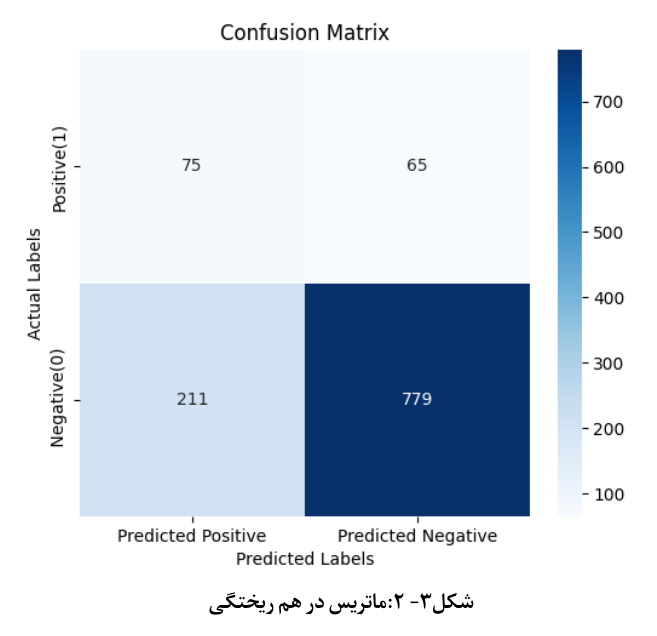
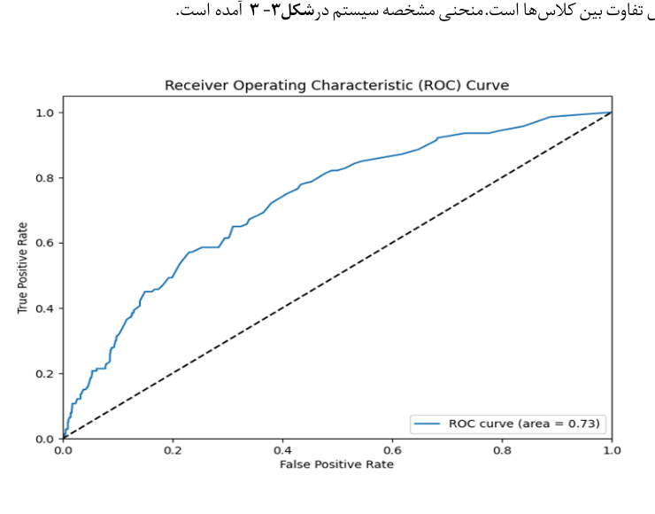
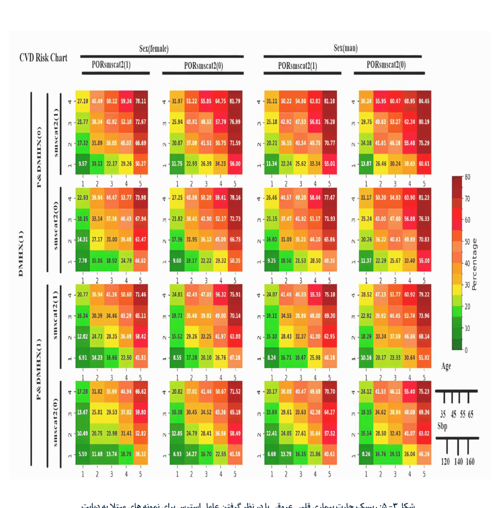

<div align="center">

# CVD Stress Risk Chart

### Statistical modelling and cardiovascular risk-chart development incorporating psychological stress

**Research project | Biomedical Engineering | Cardiovascular risk modelling**

[]()
[]()
[]()
[]()
[]()

</div>

> **Research-use notice.** This repository presents a research workflow for statistical analysis, logistic-regression modelling, and cardiovascular risk-chart visualisation. It is not a clinically validated diagnostic tool and must not be used for individual diagnosis or treatment decisions. Participant-level source data are not distributed in this repository.

---

## Project overview

Cardiovascular disease (CVD) is a major global public-health challenge. In addition to established demographic, behavioural, and physiological risk factors, psychosocial stress has been investigated as a potential contributor to cardiovascular health [1–5].

This project examines the relationship between CVD and conventional risk factors alongside psychological stress. It documents data preparation, descriptive and inferential statistics, association screening, multivariable logistic regression, model evaluation, and the construction of a multi-panel risk-chart representation.

The analytical dataset combines information from the Isfahan Healthy Heart Program (IHHP) with psychological information derived from the PHQ-4 questionnaire. The main outcome is binary CVD status.

| Project component | Description |
|---|---|
| Research topic | Cardiovascular disease and psychological stress |
| Outcome | Binary CVD status (`CVD5`) |
| Main modelling method | Multivariable logistic regression |
| Main statistical software | IBM SPSS Statistics 27.0 |
| Additional software | R 4.3.3 / RStudio, Python 3.12.4, MATLAB R2023b |
| Risk-chart design | 640 model-input combinations |
| Data availability | Participant-level data are not included |

## Research motivation and epidemiological context

CVD risk is multifactorial. Population-level evidence and public-health resources from the World Health Organization (WHO), the Global Burden of Disease (GBD) study, and cardiovascular research provide the epidemiological context for examining cardiovascular outcomes and psychosocial exposures [1–16].

Psychosocial stress has been discussed in relation to cardiovascular disease through several potential pathways, including behavioural, neuroendocrine, and physiological mechanisms [4,5,13–16]. The PHQ-4 is a brief screening instrument for anxiety and depressive symptoms; it should not be interpreted as a direct or comprehensive measure of every dimension of psychological stress [18].

### Population-level context

The following figures are included as background context. Their source attribution refers to the underlying public-health databases and publications, not to an unpublished project document. The GBD visualisations should be interpreted according to the indicator, population, year, and measure selected in the original query.

**Figure 1. Global burden measure for anxiety disorders.**  
*Source: Institute for Health Metrics and Evaluation (IHME), Global Burden of Disease Results / GBD Compare, anxiety-disorder query [8]. The plotted indicator and year should be read from the original GBD visualisation.*


**Figure 2. Cardiovascular disease mortality trends in Iran.**  
*Source: IHME, Global Burden of Disease Results / GBD Compare, cardiovascular disease query [7,9,10]. The original GBD query settings determine the selected years, age groups, sex, and mortality measure.*


**Figure 3. Comparative ranking of major causes or risk factors in Iran.**  
*Source: IHME, Global Burden of Disease Results / GBD Compare [10]. The exact ranking depends on the selected GBD measure, year, population, and cause/risk-factor view.*


> **Figure-source verification note:** The three background images are attributed to the GBD Compare source family listed in the project bibliography. Before public release, retain the original GBD query/export details (indicator, measure, year, sex, age group, location, and access date) alongside each image. Do not describe an anxiety-disorder measure as a direct measurement of all psychological stress.

## Study data and analytical cohort

The study uses information from adults in Arak, Isfahan, and Najafabad, Iran, associated with the Isfahan Healthy Heart Program. Psychological information was derived from the first two PHQ-4 questions to define the study stress indicator. The PHQ-4 was originally developed as an ultra-brief screening scale for anxiety and depression [18].

The analysis workflow includes:
- Combining the cohort data with the PHQ-4-derived information.
- Matching records using the common `IHHPCode` field.
- Defining the binary CVD outcome.
- Preparing the analysis variables and handling missing records before statistical modelling.

The analysis documentation contains differing sample counts at different stages: 3,277 records in the descriptive/methods results, 3,270 in one summary, and 3,226 in the model-evaluation description. These counts must be reconciled against the original analysis files before being presented as one definitive cohort size.

Participant-level data are not included. The repository is designed to share code, documentation, and permitted aggregate outputs without exposing confidential records.

## Variables and model structure

The binary outcome is represented by `CVD5` (0 = no CVD; 1 = CVD). The model workflow uses the following variables:

| Variable | Description |
|---|---|
| `CVD5` | Binary CVD outcome |
| `Agec` | Age category (five categories) |
| `sbp` | Systolic blood-pressure category (four categories) |
| `sex` | Sex |
| `DMHx` | Diabetes history |
| `sms2cat` | Smoking category |
| `pANDDMHX` | Stress AND diabetes logical combination |
| `pORsms2cat` | Stress OR smoking logical combination |

Exact coding, reference categories, and derivation rules should be verified against the original data dictionary and analysis scripts. They should not be inferred from variable names alone.

---

## Statistical analysis workflow

The following sections describe the analytical stages, statistical rationale, software, and reported numerical findings. Statistical methods are supported by the methodological literature and software references cited below. Study-specific values are reported as analysis outputs and should be checked against the underlying statistical files before journal submission.

### 1. Data integration and preparation

The cohort data were combined with psychological information derived from the first two PHQ-4 questions. The stress indicator (`PHQ2`) was created from the relevant questionnaire items. Records were matched through `IHHPCode`, followed by preparation of the variables required for the analysis.

**Software and tools**
- **Python 3.12.4**
- **pandas:** data loading, merging, and tabular data manipulation.
- The source data files are expected to be supplied locally; they are not distributed in this repository.

### 2. Descriptive statistics and baseline comparison

The analytical cohort was described according to CVD status. Continuous variables were summarised using measures such as mean and standard deviation and median and range. Categorical variables were summarised using counts and percentages. Group-comparison p-values were presented alongside the descriptive summaries.

Examples of reported findings include:

| Variable / comparison | No-CVD group | CVD group | Reported p-value |
|---|---:|---:|---:|
| Mean age | 48.4 years (SD 9.96) | 55.1 years (SD 10.7) | < 0.001 |
| Men | 48.0% | 55.7% | 0.00479 |
| Diabetes | 5.2% | 15.7% | < 0.001 |
| WHR category 2 | — | — | 0.912 |
| WHR category 3 | — | — | 0.484 |
| WHR category 4 | — | — | 0.209 |
| Stress indicator (`PHQ2`) | — | — | 0.665 |

The reported comparisons suggest differences between CVD groups for age, sex, diabetes, and several systolic blood-pressure categories. WHR category comparisons and the stress indicator alone were not statistically significant in the cited descriptive table.

**Software and tools**
- **R 4.3.3 / RStudio:** descriptive-table generation.
- **R `table1` workflow:** used in the analysis script for descriptive summaries.
- **Custom R p-value function:** used to select and display group-comparison p-values.
- **IBM SPSS Statistics 27.0:** used as the principal statistical analysis environment in the study.

### 3. Distribution assessment and group-comparison tests

The Kolmogorov–Smirnov test was used to assess the distribution of continuous variables. The analysis reports p-values below 0.001 for Age and `FollowDu5th` in both outcome groups, and treats these distributions as non-normal.

The Mann–Whitney U test was reported for between-group comparisons:

| Variable | Mann–Whitney U | Z | Reported p-value |
|---|---:|---:|---:|
| Age | 360,458.0 | -11.844 | < 0.001 |
| FollowDu5th | 38,947.5 | -30.232 | < 0.001 |

The methods also describe the independent-samples t-test as a parametric option when its assumptions are met. Pearson's chi-square test of independence was used for categorical variables. General guidance on these tests and their interpretation is available in the statistical references listed below [19–21].

**Software and tools**
- **IBM SPSS Statistics 27.0:** reported Kolmogorov–Smirnov and Mann–Whitney outputs and categorical comparisons.
- **R 4.3.3 / RStudio:** the descriptive-table helper uses `t.test()` for numeric variables and `chisq.test()` for categorical variables.
- The exact test used for each variable should be checked against the corresponding output and analysis code.

### 4. Categorical-variable screening and stress-related combinations

The chi-square analysis examined demographic, clinical, behavioural, and derived variables. In the reported variable-significance table, sex (p = 0.004), diabetes (p < 0.001), smoking (p = 0.007), and systolic blood-pressure categories 2–4 (p = 0.003, < 0.001, and < 0.001) were statistically significant. WHR categories and stress alone were not significant in that table. The stress-only p-value is reported as 0.622 in the variable-significance table and 0.665 in the descriptive table.

The analysis then examined logical combinations of stress with other variables, including sex, diabetes, smoking, and systolic blood-pressure categories. The results report that 32 derived variables were examined and 13 were statistically significant. Examples include stress-by-sex (p = 0.040), stress/diabetes combinations (reported p < 0.001), and stress-by-systolic-pressure combinations (reported p-values from 0.048 to < 0.001, depending on the category and logical operation).

Some derived-variable labels in the analysis tables are duplicated or ambiguous. Their exact definitions should be verified against the variable-generation code before assigning a definitive interpretation.

A p-value threshold of 0.05 is used in the reported screening. Statistical significance is not equivalent to clinical importance and does not establish causation.

**Software and tools**
- **IBM SPSS Statistics 27.0:** main statistical testing reported for categorical variables.
- **Python:** data manipulation and construction of derived variables in the relevant scripts.

### 5. Pairwise association and collinearity screening

Pairwise association analyses were performed to identify potentially redundant predictors before model fitting. The choice of association measure depends on the variable types; methodological guidance on selecting association measures is provided by Khamis [23].

**Phi coefficient (φ)**  
The Phi coefficient was used for pairs of binary variables. It was calculated from 2 × 2 contingency tables and arranged in a correlation matrix. The analysis used |φ| ≥ 0.7 as a threshold for flagging strong association and considering whether one of a pair of correlated variables should be removed.

**Biserial correlation**  
Biserial correlation was used to examine the relationship between continuous Age and binary variables.

Examples reported in the analysis include:

| Pair of variables | Reported association |
|---|---:|
| Age – DMHx | 0.2266 |
| Age – SBP category 3 | 0.3251 |
| Age – SBP category 4 | 0.3991 |
| Diabetes – `pANDDMHX` (Phi matrix) | 0.515952 |
| Smoking – `pORsms2cat` (Phi matrix) | 0.589770 |

The final candidate set described in the analysis includes sex, diabetes, smoking, systolic-pressure category indicators, the stress–diabetes logical product, and the stress–smoking logical combination.

**Software and tools**
- **Python 3.12.4**
- **NumPy and pandas:** numerical and tabular operations.
- **SciPy:** statistical functions, including contingency-table and distribution functions.
- **openpyxl:** Excel workbook output for the association matrix.

### 6. Multivariable logistic regression

The binary outcome was CVD status (`CVD5`). A multivariable logistic-regression model was fitted using age category, systolic blood-pressure category, sex, diabetes history, smoking, and the two derived stress-related terms.

The logistic model maps the linear predictor to an estimated probability through the sigmoid function:

\[
\operatorname{logit}(p)=\beta_0+\beta_1x_1+\cdots+\beta_kx_k
\]

\[
p=\frac{1}{1+\exp[-(\beta_0+\beta_1x_1+\cdots+\beta_kx_k)]}
\]

The analysis describes an 80%/20% training/test split. The modelling section refers to 3,226 records, which differs from the 3,277 records reported in the descriptive analysis. The text also refers to a 0.5 classification cut-off for the SPSS model, while the Python evaluation appendix uses a 0.55 threshold. These settings must be kept distinct.

**Software and tools**
- **IBM SPSS Statistics 27.0:** fitting the main logistic-regression model and producing coefficient estimates, standard errors, Wald statistics, p-values, odds ratios, confidence intervals, and model summaries.
- **MATLAB R2023b:** implementation of the logistic function using the reported beta coefficients.
- The MATLAB implementation shown in the analysis uses an intercept of zero. The fitted model's actual SPSS constant must be verified before the function can be treated as reproducing the model's absolute probabilities.

### 7. Regression coefficients and odds ratios

The reported coefficient table is summarised below. Exp(B) is the odds ratio associated with a model term under the specified reference coding. An odds ratio is not a risk ratio and should not be interpreted as a direct percentage change in probability.

| Model term | B | S.E. | Wald | p-value | Exp(B) / OR | 95% CI for OR |
|---|---:|---:|---:|---:|---:|---:|
| Agec(1) | -2.257 | 0.207 | 118.344 | <0.001 | 0.105 | 0.070–0.157 |
| Agec(2) | -1.453 | 0.190 | 58.433 | <0.001 | 0.234 | 0.161–0.339 |
| Agec(3) | -1.267 | 0.186 | 46.269 | <0.001 | 0.282 | 0.195–0.406 |
| Agec(4) | -0.894 | 0.210 | 18.163 | <0.001 | 0.409 | 0.271–0.617 |
| DMHx | 1.045 | 0.201 | 26.971 | <0.001 | 2.843 | 1.917–4.218 |
| sms2cat | 0.227 | 0.177 | 1.645 | 0.200 | 1.255 | 0.887–1.777 |
| pANDDMHX | -0.354 | 0.378 | 0.878 | 0.349 | 0.702 | 0.335–1.472 |
| pORsms2cat | 0.230 | 0.147 | 2.457 | 0.117 | 1.259 | 0.944–1.679 |
| sbp(1) | -1.261 | 0.194 | 42.182 | <0.001 | 0.283 | 0.194–0.415 |
| sbp(2) | -0.578 | 0.177 | 10.695 | 0.001 | 0.561 | 0.397–0.793 |
| sbp(3) | -0.294 | 0.201 | 2.144 | 0.143 | 0.745 | 0.503–1.105 |
| sex(1) | 0.190 | 0.125 | 2.308 | 0.129 | 1.210 | 0.946–1.546 |

The omnibus age-category effect is reported as Wald = 125.414 (df = 4, p < 0.001), and the omnibus systolic-pressure-category effect as Wald = 52.599 (df = 3, p < 0.001). `Agec(5)` and `sbp(4)` are the reference categories.

Several individual terms have p-values above 0.05. These coefficient-level results should be distinguished from the earlier screening of derived variables. The coefficients, coding, and reference categories should be verified against the original model output before external use.

### 8. Calibration and goodness of fit

Calibration assesses agreement between predicted probabilities and observed outcome frequencies. It is distinct from discrimination, which describes the model's ability to rank individuals with and without the outcome. Calibration concepts and evaluation hierarchies are discussed by Van Calster et al. [24].

The analysis reports a calibration intercept close to zero and a calibration slope of 1.00. The calibration statistics are:

| Calibration statistic | Reported value |
|---|---:|
| Dxy | 0.4654881 |
| C-index / C_ROC | 0.732744 |
| R-squared | 0.1280431 |
| D | 0.06905938 |
| D Chi-square | 223.7855 |
| D p-value | 0 |
| U | -0.000619963 |
| U Chi-square | 0 |
| U p-value | 1 |
| Q | 0.06967934 |
| Brier score | 0.09944395 |
| Calibration intercept | 7.43 × 10⁻¹⁵ |
| Calibration slope | 1.00 |
| Emax | 1.21 × 10⁻¹⁴ |
| Eavg | 0.01727656 |
| ECI | 0.0701933 |

The SPSS model summary reports -2 Log Likelihood = 2156.427, Cox–Snell R² = 0.512, and Nagelkerke R² = 0.683. The Hosmer–Lemeshow statistic is 5.160 with 8 degrees of freedom and p = 0.740. These are different model-fit and calibration summaries and should not be conflated with classification accuracy or ROC-AUC.

**Figure 4. Calibration plot.**  
*Source: Author-generated from the study's model predictions and observed outcomes. The calibration approach is discussed in the methodological literature [24]. This is an analysis output, not an externally sourced image.*


**Software and tools**
- **R 4.3.3 / RStudio:** calibration analysis and plot.
- **IBM SPSS Statistics 27.0:** model summary and Hosmer–Lemeshow output.
- The exact R package/function used for the calibration table is not specified here because it has not been independently confirmed from the script.

### 9. Classification performance and threshold-dependent metrics

The analysis reports accuracy, precision, recall/sensitivity, F1-score, ROC-AUC, specificity, Matthews correlation coefficient (MCC), and five-fold cross-validation.

The confusion-matrix discussion gives the following test-set counts:
- True negatives (TN) = 779
- False positives (FP) = 211
- False negatives (FN) = 65
- True positives (TP) = 75

The results summary reports:

| Metric | Value reported |
|---|---:|
| Accuracy | 0.74 |
| Precision | 0.23 |
| Recall / Sensitivity | 0.59 |
| F1-score | 0.33 |
| ROC-AUC | 0.75 |
| Specificity | 0.76 |
| Matthews correlation coefficient (MCC) | 0.24 |
| Mean five-fold cross-validation score | 0.70 |

**Figure 5. Confusion matrix.**  
*Source: Author-generated from the study's test-set predictions. The figure represents the classification evaluation performed in this project.*



**Figure 6. Receiver operating characteristic (ROC) curve.**  
*Source: Author-generated from the study's model predictions. The ROC curve is a model-evaluation output, not an externally sourced image.*



**Metric consistency note:** the prose accompanying the confusion matrix reports approximately 0.76 accuracy, 0.26 precision, 0.54 recall, and 0.35 F1. The ROC figure labels AUC at approximately 0.73, while the summary table reports 0.75. The listed confusion-matrix counts also do not reproduce every summary-table metric exactly. These differences must be reconciled against the original prediction file and analysis outputs before the metrics are quoted in a manuscript.

**Software and tools**
- **Python 3.12.4**
- **pandas and NumPy:** data handling and numerical calculations.
- **scikit-learn:** logistic-regression evaluation, classification metrics, ROC calculations, and cross-validation.
- **imbalanced-learn (SMOTE):** class resampling in the documented evaluation workflow.
- **Matplotlib:** ROC and confusion-matrix visualisation.

The original evaluation appendix describes an 80/20 split (`random_state=99`), SMOTE on the training data (`random_state=42`), and logistic regression with `C=10`, `class_weight='balanced'`, `solver='liblinear'`, and `max_iter=100`. It uses a 0.55 threshold for class predictions. The current repository evaluation script is a separate implementation; its output should not be represented as an exact reproduction unless the data, coding, split, threshold, and preprocessing are matched.

### 10. Risk-chart construction

The risk-chart workflow evaluates 640 model-input combinations:

- 5 age categories;
- 4 systolic blood-pressure categories;
- 32 combinations of five binary inputs.

Thus, 5 × 4 × 32 = 640 model-input cells.

Separate charts are presented for profiles with and without diabetes. The charts display model outputs across combinations of age, systolic blood pressure, and the selected binary predictors.

**Figure 7. CVD risk-chart visualisation for profiles without diabetes.**  
*Source: Author-generated from the study's model specification and analysis workflow. The figure is a project output, not an externally sourced image.*


**Figure 8. CVD risk-chart visualisation for profiles with diabetes.**  
*Source: Author-generated from the study's model specification and analysis workflow. The figure is a project output, not an externally sourced image.*



The chart-generation workflow uses Python tools including `pandas`, `NumPy`, `Matplotlib`, `seaborn`, and `matplotlib.colors`. MATLAB R2023b is used for the logistic-function implementation, while Python is used for the heatmap visualisation.

> **Interpretation caution:** the variables `pANDDMHX` and `pORsms2cat` are described as derived logical variables. Enumerating them independently may produce combinations that cannot occur given their source variables. The logical constraints should be checked before interpreting every cell as a feasible participant profile.
>
> **Absolute-risk caution:** the MATLAB function currently uses an intercept of zero, while the fitted SPSS constant must be verified. The repository-generated charts should therefore be described as model scores unless the intercept, variable coding, and calibration have been confirmed. Do not interpret them as validated absolute clinical probabilities.

## Software and analysis tools

| Software | Role in this project |
|---|---|
| IBM SPSS Statistics 27.0 | Main inferential analysis and logistic-regression model fitting; model coefficients, odds ratios, confidence intervals, goodness-of-fit outputs |
| R 4.3.3 / RStudio | Descriptive statistics, p-value helper functions, and calibration analysis |
| Python 3.12.4 | Data integration, association analysis, model evaluation, and risk-chart visualisation |
| MATLAB R2023b | Logistic-function implementation using model coefficients |

The exact package versions and commands should be taken from the relevant scripts and environment files. A software name in this table does not imply that every analysis stage was independently reproduced in that software.

## Repository structure

```text
cvd-stress-risk-chart/
├── README.md
├── LICENSE
├── requirements.txt
├── .gitignore
├── data/
│   ├── README.md
│   └── .gitkeep
├── docs/
│   ├── GITHUB_GUIDE.md
│   └── figures/
│       ├── 01_stress_disability_global_map.png
│       ├── 02_cvd_mortality_iran_trends.png
│       ├── 03_disease_risk_rank_iran.png
│       ├── 04_model_calibration.png
│       ├── 05_confusion_matrix_thesis.png
│       ├── 06_roc_curve_thesis.png
│       ├── 07_risk_chart_without_diabetes.png
│       └── 08_risk_chart_with_diabetes.png
├── results/
│   ├── README.md
│   ├── risk_chart_diabetes_model_score.png
│   └── risk_chart_no_diabetes_model_score.png
└── src/
    ├── 01_merge_data.py
    ├── 02_descriptive_table.R
    ├── 03_phi_correlation.py
    ├── 04_biserial_correlation.py
    ├── 05_logistic_function.m
    ├── 06_model_evaluation.py
    └── 07_risk_chart.py
```

## Code map

| Script | Purpose |
|---|---|
| `01_merge_data.py` | Merge cohort data with PHQ-4-derived data |
| `02_descriptive_table.R` | Generate descriptive statistics and group summaries |
| `03_phi_correlation.py` | Calculate Phi associations between binary variables |
| `04_biserial_correlation.py` | Examine continuous–binary associations |
| `05_logistic_function.m` | Implement the logistic function using model coefficients |
| `06_model_evaluation.py` | Run the repository evaluation workflow and generate evaluation outputs |
| `07_risk_chart.py` | Enumerate model-input combinations and generate risk-chart figures |

The scripts document components of the analysis. They do not constitute a fully automated end-to-end pipeline without the private source data and intermediate files.

## Reproducibility and execution

### Python environment

```bash
python -m venv .venv
```

Activate the environment:

```bash
# Windows PowerShell
.venv\Scripts\Activate.ps1

# macOS / Linux
source .venv/bin/activate
```

Install dependencies:

```bash
python -m pip install --upgrade pip
pip install -r requirements.txt
```

### Generate repository model-score risk charts

```bash
python src/07_risk_chart.py
```

The script writes:

```text
results/risk_chart_diabetes_model_score.png
results/risk_chart_no_diabetes_model_score.png
```

These repository-generated figures are separate from the analysis figures displayed in `docs/figures/`.

### Run model evaluation

Place the required local intermediate workbook at `data/6varcateg.xlsx` and run:

```bash
python src/06_model_evaluation.py data/6varcateg.xlsx
```

Exact outputs depend on the local input data and software environment.

### Run other analysis components

The remaining scripts require local source/intermediate files described in `data/README.md`.

```bash
python src/01_merge_data.py
Rscript src/02_descriptive_table.R
python src/03_phi_correlation.py data/final_data.xlsx
python src/04_biserial_correlation.py data/final_data.xlsx
```

Run the MATLAB function from MATLAB after preparing the input matrix in the column order documented in the function header.

## Limitations and items requiring verification

- The analysis uses data from a specific population and geographic setting in central Iran.
- Sample counts differ across the analysis summaries and must be reconciled against the source data and processing log.
- The ROC-AUC differs between the plotted curve (approximately 0.73) and the summary value (0.75).
- The prose metrics and confusion-matrix counts do not match every value in the summary table.
- The model intercept and variable coding must be verified before chart outputs can be interpreted as absolute probabilities.
- Derived logical variables may constrain which combinations are feasible.
- External validation in an independent population is required before clinical interpretation.
- The model must not be used as a diagnostic or treatment decision tool.

## Data privacy and responsible sharing

- Do not upload raw or participant-level datasets.
- Do not upload direct identifiers, dates of birth, contact details, or potentially re-identifiable records.
- Confirm that sharing any source-derived visualisation or aggregate output is permitted by the relevant data-use and licensing terms.
- Retain source metadata for third-party figures, including the original URL, query settings, access date, and licence/terms where applicable.
- Review every file before committing. `.gitignore` does not remove files that have already been committed.
- Keep the repository private unless all code, figures, and documentation have been cleared for public sharing.

## References

[1] World Health Organization (WHO), “Cardiovascular diseases.” Available: https://www.who.int/health-topics/cardiovascular-diseases

[2] National Health Service (NHS), “Cardiovascular disease.” Available: https://www.nhs.uk/conditions/cardiovascular-disease/

[3] American Heart Association, “What is Cardiovascular Disease?” Available: https://www.heart.org/en/health-topics/consumer-healthcare/what-is-cardiovascular-disease

[4] A. H. Shahsavarani, E. Azad Marz Abadi, and M. Hakimi Kalkhoran, “Stress: Facts and theories through literature review,” *International Journal of Medical Reviews*, vol. 2, no. 2, pp. 230–241, 2015.

[5] T. Dar, A. Radfar, S. Abohashem, R. K. Pitman, A. Tawakol, and M. T. Osborne, “Psychosocial stress and cardiovascular disease,” *Current Treatment Options in Cardiovascular Medicine*, vol. 21, pp. 1–17, 2019.

[6] World Health Organization (WHO), “Noncommunicable diseases.” Available: https://www.who.int/news-room/fact-sheets/detail/noncommunicable-diseases

[7] Institute for Health Metrics and Evaluation (IHME), “Cardiovascular disease, both sexes, all ages,” Global Burden of Disease Results / GBD Compare. Available: https://vizhub.healthdata.org/gbd-compare/

[8] Institute for Health Metrics and Evaluation (IHME), “Anxiety disorders,” Global Burden of Disease Results / GBD Compare. Available: https://vizhub.healthdata.org/gbd-compare/

[9] Institute for Health Metrics and Evaluation (IHME), “Cardiovascular diseases,” Global Burden of Disease Results / GBD Compare. Available: https://vizhub.healthdata.org/gbd-compare/

[10] Institute for Health Metrics and Evaluation (IHME), “GBD Compare.” Available: https://vizhub.healthdata.org/gbd-compare/

[11] G. A. Roth et al., “Global burden of cardiovascular diseases and risk factors, 1990–2019: update from the GBD 2019 study,” *Journal of the American College of Cardiology*, vol. 76, no. 25, pp. 2982–3021, 2020.

[12] World Health Organization (WHO), “Cardiovascular diseases (CVDs).” Available: https://www.who.int/news-room/fact-sheets/detail/cardiovascular-diseases-(cvds)

[13] E. Hagström et al., “Psychosocial stress and major cardiovascular events in patients with stable coronary heart disease,” *Journal of Internal Medicine*, vol. 283, no. 1, pp. 83–92, 2018.

[14] F. Satyjeet et al., “Psychological stress as a risk factor for cardiovascular disease: A case-control study,” *Cureus*, vol. 12, no. 10, 2020.

[15] European Agency for Safety and Health at Work, “The links between exposure to work-related psychosocial risk factors and cardiovascular disease.” Available: https://osha.europa.eu/en/publications/links-between-exposure-work-related-psychosocial-risk-factors-and-cardiovascular-disease

[16] M. T. Osborne, L. M. Shin, N. N. Mehta, R. K. Pitman, Z. A. Fayad, and A. Tawakol, “Disentangling the links between psychosocial stress and cardiovascular disease,” *Circulation: Cardiovascular Imaging*, vol. 13, no. 8, p. e010931, 2020. https://doi.org/10.1161/CIRCIMAGING.120.010931

[17] R. Hassannejad et al., “Developing non-laboratory cardiovascular risk assessment charts and validating laboratory and non-laboratory-based models,” *Global Heart*, vol. 16, no. 1, 2021.

[18] K. Kroenke, R. L. Spitzer, J. B. Williams, and B. Löwe, “An ultra-brief screening scale for anxiety and depression: the PHQ–4,” *Psychosomatics*, vol. 50, no. 6, pp. 613–621, 2009.

[19] SPSS Tutorials, “SPSS Chi-Square Test Tutorials.” Available: https://www.spsstutorials.com/chi-square-test/

[20] SPSS Tutorials, “SPSS Kolmogorov–Smirnov Test for Normality.” Available: https://www.spss-tutorials.com/spss-kolmogorov-smirnov-test-for-normality/

[21] SPSS Tutorials, “SPSS T-Test Tutorials.” Available: https://www.spss-tutorials.com/t-test/

[22] The source bibliography supplied for this project lists a ChatGPT conversation URL for the Mann–Whitney test. This is not a stable scholarly or methodological reference and is therefore not used as an authoritative citation here. Replace it with the actual statistical reference or software documentation used for the test before formal publication.

[23] H. Khamis, “Measures of association: how to choose?,” *Journal of Diagnostic Medical Sonography*, vol. 24, no. 3, pp. 155–162, 2008.

[24] B. Van Calster, D. Nieboer, Y. Vergouwe, B. De Cock, M. J. Pencina, and E. W. Steyerberg, “A calibration hierarchy for risk models was defined: from utopia to empirical data,” *Journal of Clinical Epidemiology*, vol. 74, pp. 167–176, 2016.

---

<div align="center">

**Statistical analysis, logistic-regression modelling, and cardiovascular risk-chart visualisation incorporating psychological stress.**

</div>
